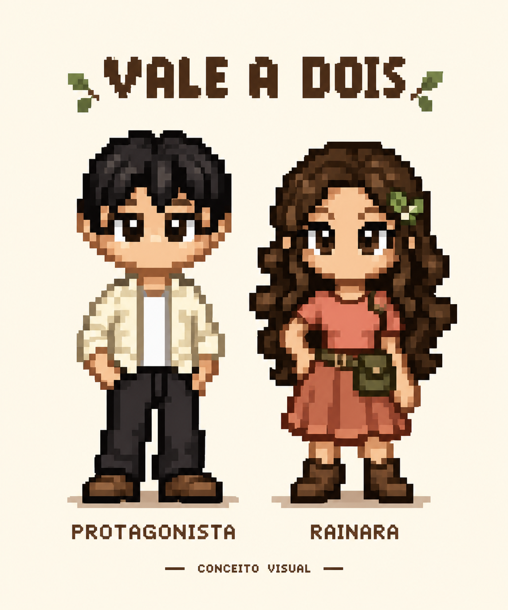
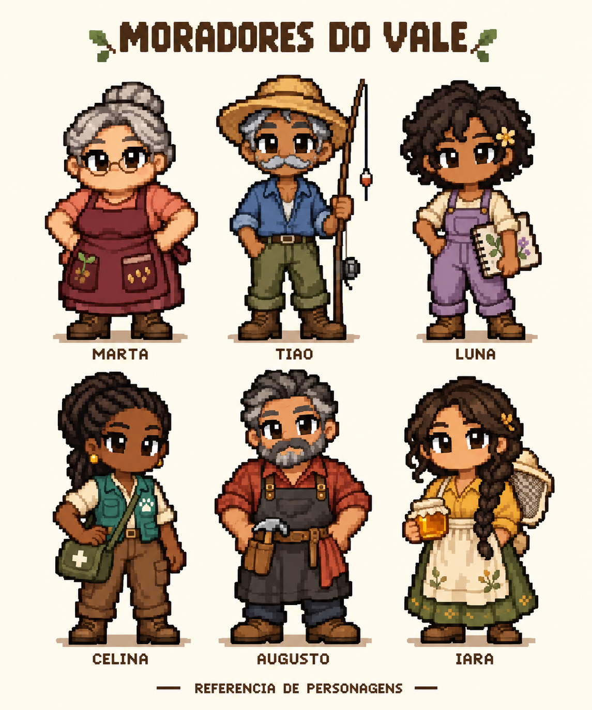
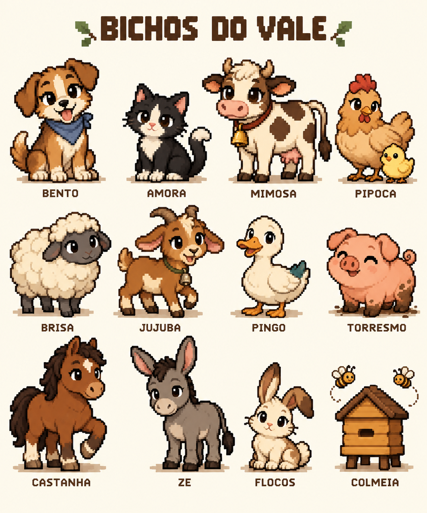
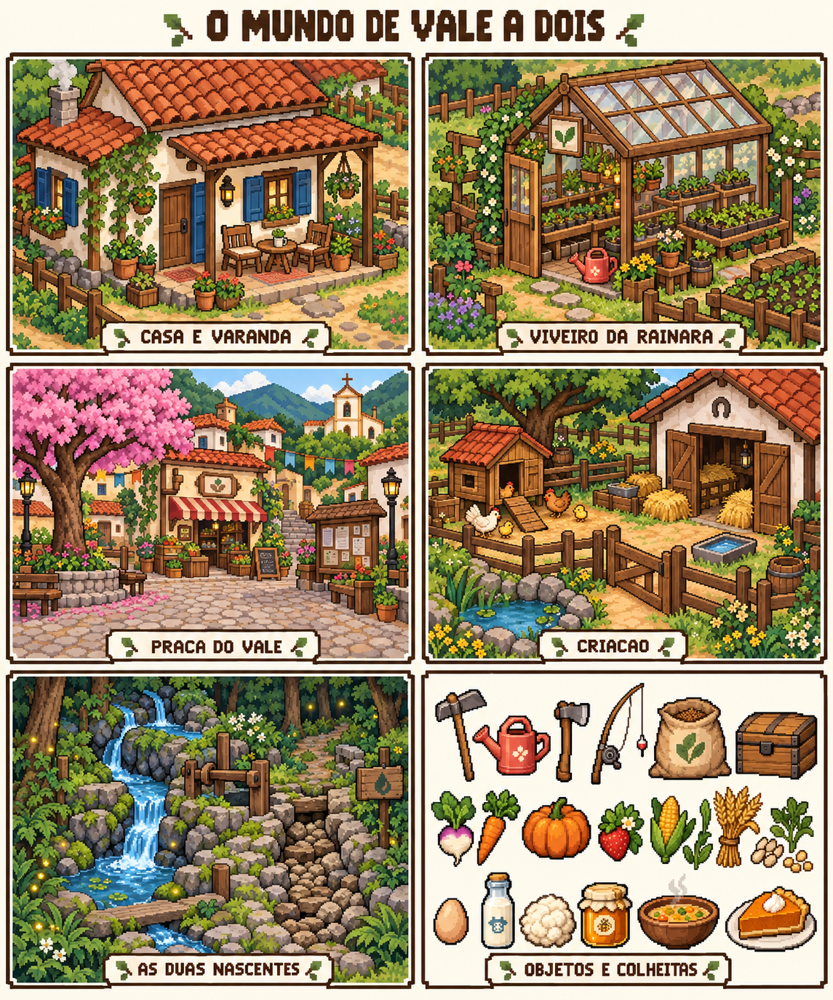
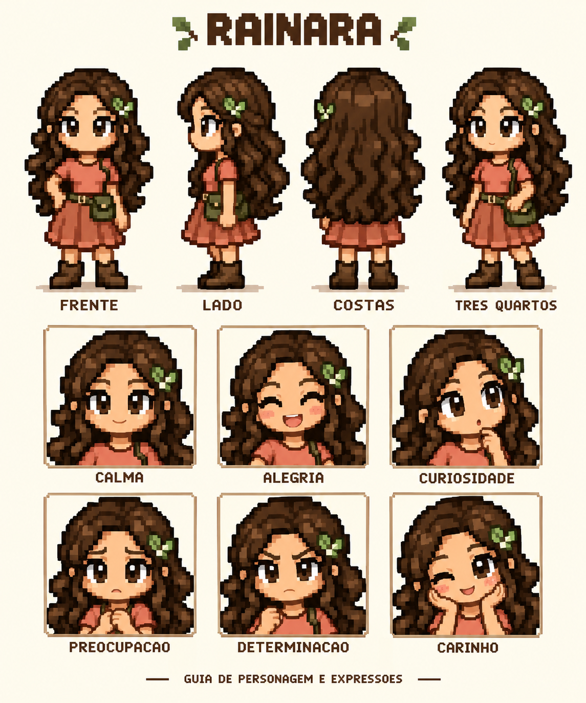

# Vale a Dois — documento mestre para implementação

Pacote criativo e técnico, versão 1.0, 12/10/2026. Este documento reúne a instrução ao Codex, a história completa, os personagens, 24 missões principais, 17 eventos pessoais/animais, 4 missões de pós-jogo, 4 festivais, 10 espécies de criação, a direção de arte e o roteiro técnico de implementação.

**Como usar:** anexe o ZIP completo ao Codex ou extraia-o na área de trabalho do repositório VALE-2. Peça para começar por `00_COMECE_AQUI.md` e ler este documento por inteiro. As imagens e os dados JSON acompanham o pacote. O documento não substitui o index.html e não deve ser colado inteiro dentro do código.

**Estado da entrega:** história e especificação criadas, cinco pranchas conceituais incluídas. Não há nesta entrega uma nova versão do jogo, sprites finais de animação ou APK; a instrução é para o Codex implementá-los, exceto APK/multiplayer que permanecem adiados.

**Precedência:** instruções atuais do proprietário > decisões desta bíblia > dados de apoio > detalhes incidentais das imagens. Preservar a aparência aprovada da dupla. Quando a referência artística apresentar escala/perspectiva inadequada para o mapa, adaptar tecnicamente o asset mantendo identidade, cores e silhueta. Não reinterpretar a história por causa de objetos incidentais na prancha.

## Roteiro de leitura

1. Instrução para o Codex.
2. Bíblia narrativa e de jogo.
3. Missões e cenas canônicas.
4. Direção de arte e animação.
5. Implementação e testes.
6. Pranchas de arte.

# Vale a Dois — instrução para o Codex

Você é responsável por implementar a evolução narrativa, visual e mecânica de Vale a Dois no repositório https://github.com/andersonx553-beep/VALE-2. Leia `VALE_A_DOIS_DOCUMENTO_MESTRE.md` inteiro e os dados em `conteudo/` antes de editar. As imagens em `arte/` são referências conceituais originais produzidas para este pacote, não atlases de animação prontos.

## Objetivo autorizado

Continue o jogo existente. Implemente a história completa das Duas Águas, Rainara como coprotagonista permanente, o elenco, as espécies, os eventos, as melhorias de interface e a direção visual deste documento. A prioridade é um jogo individual consistente, com todas as funcionalidades realmente utilizáveis. Multiplayer e APK ficam fora desta entrega.

## Antes de começar

1. Confirme repositório, branch, alterações locais e instruções existentes. Leia o `index.html` completo. Não sobrescreva trabalho mais recente.
2. Compare a implementação com esta especificação. Na inspeção de 12/10/2026, a main estava em `0fd172de6262c45062bc81babc3c1940ae42fb04`, com um index.html de 68.934 bytes. Esse SHA é apenas referência histórica, não uma ordem de reset.
3. Reconheça o que já funciona: estações de 14 dias, culturas, pesca, casa, culinária, construções, vacas/galinhas, rotinas, presentes, missões e save. Preserve e amplie esses sistemas.
4. Crie uma branch própria. Faça um plano de implementação por marcos, com critérios de aceite. Prossiga sem pedir aprovação para cada pequeno detalhe já especificado.

## Regras de implementação

- Mantenha a distribuição do jogo em um HTML autocontido, CSS/JS inline, sem bibliotecas ou pedidos de rede em tempo de execução. Imagens finais podem ser incorporadas como data URLs; o código de construção e as fontes artísticas podem existir fora do HTML no repositório.
- Não reescreva do zero. Preserve Canvas, cache do terreno, câmera, estado simples e y-sort; introduza apenas as estruturas necessárias para conteúdo, cenas, companheira e espécies.
- A aparência obrigatória é pixel art chibi expressiva das pranchas, com cabeça grande, olhos grandes e contornos marcados. Não substituir por desenho vetorial liso, 3D ou bonecos genéricos de retângulos.
- Prepare sprites reais com grade consistente. Não use a prancha inteira como sprite, nem recorte retratos arbitrariamente e os declare animação. Se não houver ferramenta de imagem, produza atlases raster com autoria de pixels e Canvas, guiados pelas referências; mantenha uma lista honesta do que falta atingir visualmente.
- Rainara permanece no pós-jogo e não exige romance. Relação, tarefas e cenas têm estado persistente, sem eventos duplicados.
- Use IDs estáveis; salve com versionamento e migração. Preserve saves existentes, inventário, animais, construções e missões já concluídas. Nunca apague progresso silenciosamente.
- Recursos de toque, teclado, áreas seguras, legibilidade e acessibilidade fazem parte da conclusão de cada marco.
- Trabalhe pelos marcos do documento. Primeiro entregue uma abertura completa com Rainara, arte representativa, uma missão e persistência. Depois complete campanha, elenco, criação e pós-jogo.
- Toda ação relevante deve gerar retorno visual e uma consequência real. Não deixe placeholders, botões vazios, texto prometendo recursos ausentes ou recompensas que não existem.

## Validação e continuidade

Faça checagem de sintaxe e teste em navegador quando disponível. Verifique console, toque, colisões, transições, save antigo/novo, perda de foco, eventos interrompidos e objetivos já cumpridos. Valide progressão até o final com um save de teste, sem deixar atalhos de depuração na versão final. Meça carregamento e desempenho no ambiente disponível e descreva o aparelho/viewport usado; não alegue testes em dispositivo físico sem realizá-los.

Se precisar dividir o trabalho em sessões, grave `PROGRESSO_VALE2.md` com o marco concluído, os testes reais, os arquivos alterados e o próximo passo exato. Não declare o projeto inteiro pronto ao concluir apenas a primeira parte.

Ao concluir: entregue mudanças, controles, roteiro de teste, pendências reais, commits e PR. Não faça merge nem publique por causa deste documento sozinho: siga a autorização existente na sessão de implementação. Não gere APK.

Comece inspecionando os arquivos e implementando o marco M0. O documento e o conteúdo canônico abaixo já definem a direção criativa; a tarefa é transformá-los em jogo.


# Vale a Dois
## Bíblia narrativa e de jogo

Versão 1.0 — 12 de outubro de 2026. Autor da encomenda: proprietário do projeto VALE-2. Destinatário: Codex e equipe de desenvolvimento. Este documento define a criação original a implementar e amplia o jogo existente. Ele é uma especificação de produção; não afirma que o conteúdo proposto já esteja implementado.

## 1. Visão e promessa ao jogador

Vale a Dois é um jogo individual de fazenda, convivência e descoberta em uma serra brasileira imaginária. O jogador estabelece sua vida na Fazenda Entreáguas ao lado de Rainara, cria animais, conhece os moradores e recupera um sistema de água que se tornou o centro de uma antiga divisão da comunidade.

O prazer central é perceber sinais concretos do próprio cuidado: a primeira muda sobrevivendo, um animal que passa a se aproximar, uma receita preparada por alguém, o viveiro de Rainara ficando cheio e um caminho antes seco recebendo água. Cada sistema deve sustentar uma dessas experiências.

O nome Vale a Dois tem três sentidos: as duas nascentes que formaram a região, a antiga regra de manutenção em dupla e a vida construída pelo protagonista e Rainara. Não depende de multiplayer ou romance.

Tom: afetuoso, curioso e bem-humorado, com conflitos humanos compreensíveis. Classificação criativa pretendida: experiência familiar; sem violência gráfica, abate ou morte punitiva dos animais. Isso não é uma classificação etária oficial. O jogo pode abordar culpa, solidão e despedidas temporárias com leveza e respeito.

### Decisões e complementos já incorporados

- Diário das Duas Águas: reúne missões, mapas, desenhos de Luna, receitas e lembranças das cenas. O jogador pode reler diálogos importantes.
- Ritual da varanda: pequenas cenas de fim de dia com Rainara e Bento. Variam conforme o que aconteceu; não interrompem todo entardecer.
- Pós-jogo: o final resolve o conflito principal e abre festivais recorrentes, criações, decoração e cenas de parceria.
- Cuidado compartilhado: Rainara executa tarefas combinadas de verdade; sua ajuda não gera itens do nada.
- Modo tranquilo: ajustes de velocidade do relógio, janela de pesca e tamanho do texto. Sem penalidade por usar acessibilidade.
- Memória do mundo: moradores reconhecem a nascente restaurada, animais têm nomes preservados e construções se transformam visualmente.

## 2. Cânone do lugar

### Geografia

O Vale das Duas Águas fica numa serra fictícia. O clima mantém as quatro estações de 14 dias já presentes no código. O inverno frio e a neve são convenções desse mundo; não representam uma região brasileira real. O cenário mistura vegetação de altitude, pomares, hortas, mata úmida e pequenas propriedades.

A Nascente Clara desce pelo lado leste e ainda abastece a vila. A Nascente da Sombra percorre um canal de pedra pelo oeste; seu antigo leito ficou seco. Elas se encontram junto à Fazenda Entreáguas. A água é comum e material: os vaga-lumes azuis e os sons noturnos inspiram histórias, mas não substituem reparos, manejo ou decisões humanas.

O mapa atual de 80 × 60 tiles é a região Fazenda. Preserve seu terreno e coordenadas na migração. Adicione Praça, Bosque, Alto das Nascentes e interiores como regiões separadas, por transições visíveis nas bordas ou portais. Não comprima todos os novos edifícios na fazenda existente.

### Linha do tempo

| Momento | Fato canônico |
| --- | --- |
| Há 70 anos | Famílias da serra constroem canais e um pequeno viveiro comunitário. Duas pessoas operam a distribuição: uma na comporta e outra observando o nível a jusante. |
| Há 28 anos | Helena, mãe de Rainara, começa um caderno com mapas, mudas e rotinas de manutenção. Tião acompanha as medições; Augusto repara as estruturas. |
| Há 12 anos | Uma tempestade ameaça casas baixas. Tião e Augusto abrem um desvio de emergência. A vila é protegida, mas lama bloqueia parte do canal da Sombra. |
| Nos meses seguintes | A manutenção é adiada por falta de materiais e por discordâncias. A produção das terras de oeste cai. Versões incompatíveis sobre o incidente circulam. |
| Há 8 anos | O viveiro fecha. Helena conserva o caderno; Iara muda suas colmeias e outras famílias deixam propriedades. |
| Há 3 anos | Helena passa a viver em outra cidade para ajudar a irmã. Continua escrevendo para Rainara. Celina inicia visitas regulares ao vale. |
| Hoje | A associação oferece a propriedade Entreáguas em cessão de uso para quem cuidar dela. O protagonista aceita e Rainara assume a parceria no viveiro e nos cuidados. |

Helena está viva. Não há desaparecimento a resolver nem morte secreta de Rainara. A campanha revela uma decisão de emergência seguida de omissões, culpa e falta de cooperação. Nenhum personagem é um vilão corporativo ou um escolhido mágico.

### A verdade da segunda nascente

A fonte nunca secou por completo. Sedimentos bloquearam a entrada do canal; a água passou a escorrer por uma fenda, alimentando uma pequena zona úmida escondida. Abrir a comporta de uma vez inundaria os terrenos baixos e prejudicaria esse novo habitat. O final exige limpar o canal, reconstruir um vertedouro e ajustar o fluxo gradualmente, preservando a zona úmida.

Rainara encontra o desenho; Tião interpreta as marcas de nível; Augusto reconhece a peça retirada; Marta apresenta as contas que explicam a manutenção interrompida; Luna organiza os relatos; Celina e Iara observam os efeitos sobre animais e plantas. O jogador reúne os recursos e participa das decisões. A recuperação depende de toda a comunidade.

## 3. História completa

### Prólogo — Duas cadeiras

O protagonista chega à Entreáguas com uma mala e o termo de cessão. Rainara tenta endireitar uma cerca enquanto Bento rouba uma luva. Ela já trouxe sementes e instalou uma segunda cadeira na varanda. O primeiro objetivo é guardar a mala, conhecer o terreno e plantar três nabos. À noite, a dupla divide uma refeição simples. Rainara aponta um canal seco e comenta que antes era possível ouvir duas águas da varanda.

A personalização permite nome, aparência e pronomes do protagonista; o código deve usar flexões neutras por construção quando não houver configuração. O passado não determina profissão, gênero ou romance. A motivação é escolhida na conversa inicial: recomeçar, aprender ou criar raízes. A escolha altera falas e uma lembrança do diário, sem vantagens mecânicas.

### Ato I — O que fica de pé

Marta ajuda com sementes; Tião ensina a observar o lago; Luna pede autorização para desenhar a fazenda. Celina entrega uma galinha adulta de acolhimento, Pipoca, quando existe abrigo e comida. Rainara deseja reabrir o viveiro, mas tenta fazer tudo sozinha. O jogador encontra uma tampa de inspeção entre raízes. A primeira conquista coletiva é uma sopa compartilhada, usando a missão original de Marta como ponte para a nova campanha.

Conclusão: o caderno de Helena indica que o canal da Sombra atravessa a fazenda. Um pedaço do mapa foi separado para orientar uma manutenção que nunca terminou.

### Ato II — Vozes do mesmo lugar

Cada morador tem uma versão da tempestade. Tião afirma que foi necessário abrir o desvio. Augusto evita mostrar uma peça guardada na oficina. Iara lembra das flores desaparecendo. Marta manteve o armazém funcionando com estoques que não foram pagos. Luna quer registrar os relatos sem transformar uma pessoa em culpada por todos.

A busca integra a vida normal: fornecer uma refeição para uma caminhada, recuperar uma passagem, cuidar da primeira vaca com Celina e plantar flores próximas ao viveiro. No fim do ato, Helena envia uma carta: a tarefa era restabelecer o sistema depois da emergência, não retornar a um passado perfeito.

Conclusão: Rainara e o jogador encontram a peça de controle e localizam o acesso à fonte. O viveiro volta a funcionar em escala pequena.

### Ato III — A pressa e a confiança

Rainara quer abrir o canal antes da próxima semana seca; o jogador e a comunidade precisam medir os riscos. Acompanhá-la ao alto mostra a zona úmida que nasceu do desvio. Tião admite que não voltou para terminar a manutenção por vergonha e medo de ser responsabilizado. Augusto admite que escondeu a peça para impedir uma abertura improvisada, mas nunca explicou isso aos vizinhos.

Rainara sente que as explicações chegam sempre depois de alguém desistir. Sua discussão com o protagonista trata de divisão de responsabilidade. Há três respostas válidas: medir juntos, pedir ajuda ou conversar antes de agir. Todas levam a um plano seguro; mudam o diálogo de reconciliação, não expulsam a personagem do jogo.

Conclusão: a dupla deixa de tentar resolver o vale sozinha. Um quadro de tarefas divide trabalho, materiais e observação de campo.

### Ato IV — O trabalho de muitas mãos

A comunidade organiza um mutirão. Celina verifica acesso a bebedouros; Iara cuida do plantio junto às margens; Luna sinaliza caminhos; Marta cozinha; Augusto monta o vertedouro; Tião acompanha os níveis. Rainara e o jogador testam a distribuição em etapas. A cena de duas alavancas é uma interação individual com Rainara controlada pelo jogo, sem networking.

Na primeira abertura a água fica turva. É preciso pausar e limpar um filtro de galhos. Esse obstáculo demonstra o aprendizado, sem destruir a fazenda ou penalizar animais. A segunda abertura estabiliza o fluxo. O jogador escolhe qual projeto receberá o primeiro excedente: o pomar comunitário ou a área de sombra dos animais. O outro projeto continua disponível no pós-jogo com custo equivalente.

Conclusão: água corrente no canal, mudança no ambiente sonoro, novas plantas ao longo das margens e moradores usando o caminho recuperado.

### Epílogo — A mesa comprida

O Festival das Duas Águas acontece quando o jogador confirma que está pronto. Não depende de esperar uma estação específica. Cada morador traz algo: Marta a panela, Tião um banco, Luna um retrato coletivo, Celina um sino para o abrigo, Augusto uma mesa e Iara pão com mel. Helena envia uma receita e uma mensagem de orgulho; sua ausência física não exige novo sprite.

Rainara conta que tinha preparado a segunda cadeira para uma pessoa que talvez fosse embora. Agora deixou um espaço para visitantes ao lado das duas. O jogador escolhe a fala final conforme a relação: amizade, parceria ou romance já declarado. A dupla observa os canais ao entardecer; Bento dorme perto. Os créditos podem ser pulados e o save retorna à manhã seguinte.

Última fala de Rainara: “Amanhã a gente vê o que precisa de cuidado. Hoje, fica mais um pouco.”

## 4. Personagens completos

### Protagonista

Nome escolhido; adulto. Visual padrão: cabelo preto, pele morena clara, jaqueta creme, camiseta branca, calça escura e botas castanhas. O conceito enviado pelo usuário orienta proporção e rosto. Personalizações futuras preservam legibilidade e o estilo.

Desejo: criar uma vida própria. Conflito: encontrar equilíbrio entre produzir, conhecer as pessoas e descansar. Sua voz oferece escolhas curtas e naturais. Não supor abandono familiar, luto ou profissão anterior. O protagonista nunca é obrigado a paquerar para progredir.

### Rainara — 26 anos — viveirista e coprotagonista

Visual canônico: cabelos castanhos longos e ondulados, olhos castanhos grandes, pele morena, blusa coral, saia terracota, bolsa verde-oliva, botas e presilha de folha. Nas tarefas, usa avental e luvas sobre esse conjunto; não perde sua identidade visual. Silhueta marcada pelo cabelo e pela bolsa.

Desejo: recuperar o viveiro e ficar no vale por escolha, não por obrigação. Medo: que aceitar ajuda signifique dever sua vida aos outros. Defeito: trabalha além do combinado e decide por quem acha estar protegendo. Qualidades: observação, persistência, humor rápido, habilidade com mudas. Mania: desenha uma pequena folha ao encerrar anotações. Não gosta de desperdício de sementes; gosta de sopa, morangos e presentes feitos com intenção.

Arco: começa organizando tudo; aprende a negociar, confiar e descansar. Relações: filha de Helena; afeto franco com Marta; admiração impaciente por Tião; amizade com Luna; confiança profissional em Celina. Sua relação com o jogador nunca substitui as demais.

Rotina base: 7h varanda; 8h–11h viveiro; 11h–12h praça; 12h refeição; 13h–17h tarefas próprias ou combinadas; 18h retorno; 19h varanda; 21h descanso. Em acompanhamento, reserva uma tarefa própria para outro horário sem desaparecer nem bloquear missões.

Falas de voz: “Essa muda parece parada. Está criando raiz.” / “Você pode dizer que não sabe. Eu também estou aprendendo.” / “O Bento enterrou minha luva. Tecnicamente, ele começou a plantação.”

Romance opcional: adultos, desbloqueado por conversa explícita após confiança suficiente. Opção “Quero nossa parceria como ela é” preserva todas as funções e cenas centrais. Não usar ciúme punitivo, casamento obrigatório ou abandono. Rainara permanece depois dos créditos.

### Dona Marta — 58 anos — comerciante

Visual: coque grisalho, óculos pequenos, blusa coral e avental vinho com bolsos. Corpo arredondado e postura firme. Mora sobre o armazém. Desejo: manter o lugar onde todos se encontram. Medo: admitir que já não consegue sustentar o armazém sozinha. Guarda cadernetas de crédito e receitas, não segredos malignos.

Arco: transforma favores silenciosos em acordos claros da comunidade. Voz: objetiva, carinhosa sem infantilizar. “Desconto eu calculo. Amizade a gente conversa.” / “Sopa boa precisa de tempo. Gente também.” Prefere nabo, sopa e morango; não aprecia pedra como presente. 8h–18h loja; intervalo 12h–13h com caixa de retirada funcional; 19h jantar; 21h casa. Missão pessoal: Livro de fiados; recompensa: receita de pão de milho e prateleira decorativa.

### Tião — 63 anos — pescador e conhecedor da água

Visual: pele morena, bigode grisalho, chapéu de palha, camisa azul, calça oliva, vara. Desejo: voltar a ser útil sem precisar explicar o que fez. Defeito: responde com provérbios quando deveria responder diretamente. Medo: que reconhecer um erro apague tudo o que ajudou a construir.

Arco: relata a emergência inteira e participa da reparação. “Água não esquece o caminho. A gente é que tapa.” / “Hoje eu vim conversar. Os peixes podem esperar.” Gosta de peixe assado; desgosta de abóbora crua como presente. 7h–11h lago grande; 12h refeição; 14h canal; 17h ponte; 20h casa. Na chuva forte, prepara linhas na varanda. Missão pessoal: Banco da margem; recompensa: receita de isca simples e banco.

### Luna — 23 anos — desenhista e cronista

Visual: pele negra, cabelo curto cacheado, jardineira lavanda, blusa creme, caderno e pequena flor amarela. Desejo: estudar ilustração e mostrar o vale ao mundo. Medo: ser acusada de abandonar quem ama. Defeito: transforma conversas em projetos antes de perguntar se pode registrá-las.

Arco: prepara uma exposição com consentimento dos moradores e escolhe uma temporada de estudo com retornos regulares. Isso não a remove permanentemente do jogo. “Posso desenhar? Tem coisa que só aparece quando a gente para.” / “Ir embora por um tempo não é apagar o caminho de volta.” Gosta de torta e abóbora. 9h praça; 11h bosque; 14h atelier; 17h ponte; 21h casa. Missão pessoal: Retratos com licença; recompensa: retratos decorativos e página ilustrada do diário.

### Celina — 37 anos — veterinária

Visual: pele negra, tranças presas, colete verde-petróleo, bolsa de cuidados, camisa creme e calça castanha. Desejo: estabelecer uma pequena estação permanente de cuidado animal. Defeito: tenta resolver inseguranças com instruções. Medo: chegar tarde quando alguém precisa de ajuda.

Arco: aprende a ensinar, compartilhar trabalho e aceitar que afeto tem muitas formas. “Primeiro observe. Nem todo silêncio é descanso.” / “Ela já conhece sua voz. Agora aprenda os sinais dela.” Prefere omelete e leite; presentes não substituem cuidados reais. 8h–11h abrigos; 12h praça; 14h–18h estação; 20h casa. Torna-se residente após o abrigo comunitário. Missão pessoal: Plantão dividido; recompensa: escova, cuidados preventivos e espaço de adoção.

### Augusto — 56 anos — carpinteiro

Visual: barba sal e pimenta, camisa xadrez ferrugem, avental cinza, ferramenta no cinto. Desejo: construir algo que os outros possam manter sem depender dele. Defeito: esconde informações quando acha que só ele entende o risco. Medo: um reparo seu falhar.

Arco: entrega a peça guardada e explica a técnica para os demais. “Se só eu consigo consertar, ainda não terminei o serviço.” / “Essa marca torta fui eu. Funciona há vinte anos.” Gosta de pão e queijo; madeira pode ser presente comum, não item amado infinito. 8h–12h oficina; 14h–17h encomendas; 18h praça; 21h casa. Missão pessoal: A cadeira que balança; recompensa: móveis e projeto de ponte.

### Iara — 41 anos — apicultora e cozinheira

Visual: trança longa, blusa mostarda, saia verde, avental creme e véu de apicultura dobrado. Desejo: recuperar a variedade de flores e abrir uma cozinha de encontros. Defeito: faz piada para evitar discussões. Medo: investir de novo onde já perdeu trabalho.

Arco: planta primeiro um canteiro pequeno e volta a confiar no lugar. “Mel de uma flor só conta uma história curta.” / “Prove antes de dizer que não gosta. Vale para conversa também.” Prefere mel e frutas; não gosta de peixe cru. 7h–10h colmeias; 11h–14h cozinha; 16h horta; 19h praça; 21h casa. Missão pessoal: Receita sem medida; recompensa: pão com mel e colmeia.

### Bento, Amora e Helena

Bento: cachorro caramelo, uma orelha caída, lenço azul; curioso e afetuoso, teme trovões. Brinca, dorme, acompanha, encontra objetos já existentes e reage à chegada de Rainara. Não gera itens infinitos. O vínculo abre uma animação de oferecer a pata e uma cena sob a mesa na tempestade.

Amora: gata preta e branca, patas claras; passa a visitar a fazenda após a cozinha ser construída. O jogador pode adotá-la preparando cama, água e alimento. Gosta da janela quente e respeita abrigos dos bichos menores. Não caça os animais do jogador.

Helena: mãe de Rainara, 52 anos, vive fora do vale cuidando da irmã. Participa por cartas em pontos definidos da campanha; não exige arte animada na primeira versão. Seu caderno é técnico e afetivo. Sua voz é franca: “Eu anotei o que soube. O que vocês descobrirem agora também merece uma página.”

## 5. Rainara como sistema jogável

Estados: rotina, acompanhar, esperar, executar tarefa, conversar, participar de cena, descansar. O comando “Vamos juntos?” aparece em interação direta e no caderno depois da abertura. “Pode seguir sua rotina” encerra acompanhamento com confirmação visual, sem punição afetiva. Ela se mantém a 1–2 tiles, contorna obstáculos e não empurra o jogador. Após 3 segundos sem caminho, recalcula; se continuar presa e fora de cena, reposiciona-se em um tile válido próximo, discretamente, sem atravessar uma porta bloqueada.

Tarefas iniciais: regar até 8 tiles acessíveis; alimentar até 3 animais; coletar até 6 produtos prontos; colher até 6 cultivos maduros. Uma tarefa combinada por dia, duas após o evento R03. Usa água/ração da reserva compartilhada visível e deposita produtos num cesto acessível. Se não houver recurso, ela informa e para. Nunca usa itens marcados como reservados para missão, vende produtos ou altera plantações sem autorização.

Tarefas duram no mínimo uma ação animada por alvo; o mesmo alvo fica reservado durante a operação. Jogador pode cancelar. A conclusão gera um recibo no diário: feitos, insumos e pendências. O save guarda tarefa, alvos restantes e itens já transferidos. O efeito de uma ação não pode repetir ao recarregar.

Confiança: 0–100; conversa significativa +2 uma vez ao dia; tarefa compartilhada +3 uma vez ao dia; evento pessoal +8; presente apreciado +2, máximo um por dia. Sem decadência por ausência. Eventos R01/R02/R03/R04/R05 em 10/25/40/60/80, com condições de história descritas no conteúdo. Não exigir esperar vários anos para chegar ao final: campanha concede confiança suficiente. Romance usa uma flag explícita, independente da pontuação.

## 6. Animais e manejo

Os animais são indivíduos. Nome pode ser editado com até 20 caracteres, inserido na UI com textContent. Cada animal tem ID, espécie, variante de cor, temperamento, idade em dias, abrigo, vínculo, saciedade do dia, água, higiene, conforto, estado e produtos armazenados. Limite inicial de 24 animais de criação no mundo ativo, ampliável só após medir desempenho. Pets e colmeias têm contagem separada.

Três temperamentos: tranquilo (aproximação lenta), curioso (investiga objetos seguros) e reservado (demora mais a aceitar carinho). Nenhum reduz permanentemente a rentabilidade; diferenças são de comportamento. Os nomes sugeridos das pranchas são os primeiros indivíduos, renomeáveis.

| Espécie | Primeiro nome | Abrigo | Maturidade de filhote | Produto ou função | Ciclo em dias bem cuidados |
| --- | --- | --- | --- | --- | --- |
| Galinha | Pipoca | Galinheiro | 3 | Ovo | 1 |
| Vaca | Mimosa | Estábulo | 7 | Leite | 1 |
| Cabra | Jujuba | Estábulo | 5 | Leite de cabra | 1 |
| Ovelha | Brisa | Estábulo | 5 | Lã por tosquia | 3 |
| Pato | Pingo | Galinheiro com lago | 4 | Ovo de pato | 2 |
| Porco | Torresmo | Pocilga sombreada | 6 | Composto e raízes comuns | 2; uma busca diária opcional |
| Cavalo | Castanha | Baia | 8 | Montaria | Sem produto periódico |
| Burro | Zé | Baia | 8 | Transporte de carga entre pontos | Sem produto periódico |
| Coelho | Flocos | Coelheira | 3 | Companhia e pelo escovado | 3; sem pés de coelho |
| Abelhas | Colmeia | Apiário | 3 de instalação | Mel | 3, com flores; suspenso no inverno |

Regras são abstrações de jogo, não instruções de criação real. Não há abate, doença fatal ou morte por ausência. Negligência reduz conforto e suspende produção; o jogador recupera a rotina com comida, água, limpeza e descanso. Ausência fora do jogo não avança o calendário.

### Produção e qualidade

Na passagem de dia, avalie o dia encerrado antes de zerar indicadores. Adulto alimentado, com água e abrigo válido acumula 1 dia de ciclo. Carinho melhora vínculo, mas não é requisito absoluto de sobrevivência nem de produção básica. Conforto 0–100: alimentação +40, água +30, abrigo limpo +20, interação respeitada +10. Qualidade boa a partir de 80 e vínculo 30; excelente a partir de 95 e vínculo 70. Preço: base ×1 / ×1,25 / ×1,5, arredondado para baixo.

Cada produção recebe ID composto por animal, dia e sequência. Produtos podem acumular até 3 ciclos; aviso de coleta ao atingir o limite. Nunca apague produtos existentes em migração. Filhotes não produzem. Chuva e frio fazem os bichos buscar abrigo; patos podem nadar quando seguro. A saída do abrigo não requer animação de porta perfeita para calcular cuidado: a simulação deve ser coerente mesmo fora da câmera.

Água de bebedouro tem capacidade por abrigo, consumo diário visível e reposição simples. Ração é comprada ou preparada de milho/trigo; pasto pode cobrir a necessidade dos herbívoros em dia seco, com área suficiente e acesso. Não exigir que jogador alimente dezenas de indivíduos por menus repetidos: cochos e um resumo do abrigo permitem cuidar em grupo.

### Novos bichos e reprodução

Os primeiros exemplares comprados são adultos. Filhotes são opcionais, desbloqueados por Celina depois de um abrigo melhorado. Galinhas/patos: incubação de ovos férteis comprados, 3 dias. Mamíferos: serviço de reprodução solicitado a Celina para adulto com vínculo 50, abrigo limpo e vaga reservada; 5 dias para o nascimento. Modelo abstrato sem genética ou sexo obrigatório na UI. Um pedido por abrigo por vez. Cancelar devolve apenas recursos não consumidos, conforme aviso prévio. A espécie do filhote é fixa e não há sorteio frustrante.

### Primeiras histórias animais

Pipoca prefere o canto da cerca; construir o ninho resolve ovos fora do lugar e abre uma cena engraçada com Rainara. Mimosa se assusta com o martelo de Augusto; combinar o horário do reparo cria confiança. Jujuba sobe num caixote; oferecer um ponto seguro para escalar encerra a fuga. Brisa reconhece o som da escova; escovar três dias diferentes libera uma pose de aproximação. Pingo segue Bento até a água; uma rampa permite retornar. Amora escolhe a cadeira do jogador; a cama junto à janela oferece uma alternativa. Nenhuma dessas cenas destrói itens ou pune afeto.

## 7. Economia, construções e receitas

Preserve preços existentes na migração; estes valores são ponto inicial para itens novos e precisam de playtest. A primeira galinha e um pacote de ração são recompensa da campanha após construir abrigo, sem exigir compra de outro animal para avançar. Missões principais aceitam peixes de qualquer espécie quando a identidade não importa.

| Produto novo | Venda base G | Destino |
| --- | --- | --- |
| Leite de cabra | 42 | Queijo e cozinha |
| Lã | 65 | Tecelagem e venda |
| Ovo de pato | 45 | Cozinha |
| Composto | 18 | Solo ou venda |
| Pelo escovado | 35 | Almofada e artesanato |
| Mel | 70 | Pão com mel e presentes |
| Queijo | 95 | Mesa compartilhada e venda |
| Queijo de cabra | 110 | Receitas e presentes |

| Construção nova | Custo inicial | Capacidade e condição |
| --- | --- | --- |
| Ampliação do galinheiro | 240 G, 20 madeira, 12 pedra | 6 aves; mantém as existentes |
| Ampliação do estábulo | 500 G, 35 madeira, 25 pedra | 6 animais; mantém os existentes |
| Lago de patos | 120 G, 10 pedra | Ligado ao galinheiro; saída caminhável |
| Pocilga | 350 G, 25 madeira, 15 pedra | 3 porcos; sombra e lama |
| Baia | 600 G, 40 madeira, 20 pedra | 2 montarias |
| Coelheira | 180 G, 15 madeira, 5 pedra | 4 coelhos |
| Apiário | 200 G, 12 madeira | 2 caixas; exige flores próximas |
| Queijeira | 180 G, 12 madeira, 8 pedra | Uma unidade por ciclo |
| Tear | 220 G, 20 madeira | 2 lãs para 1 tecido |

Receitas novas: queijo = 2 leites, 1 dia; queijo de cabra = 2 leites de cabra, 1 dia; pão de milho = 2 milhos + 1 trigo, instantâneo; pão com mel = 1 pão de milho + 1 mel; ensopado da serra = 1 cenoura + 1 abóbora + 1 queijo; chá do viveiro = 2 ervas coletadas. Preservar sopa, peixe assado, torta e omelete existentes.

Benefícios: chá reduz pela metade o tempo de recuperação das ferramentas durante 120 minutos de jogo, sem dobrar produção animal; pão com mel amplia janela de pesca como o benefício existente; ensopado prolonga corrida, sem empilhar multiplicadores. Efeitos do mesmo tipo renovam duração até um teto; não acumulam potência.

Itens narrativos ficam numa bolsa de história não vendável e não ocupam espaço de inventário. Materiais de reparo são comuns; sempre existe alternativa de compra ou coleta renovável. Recursos de missão não dependem de sorte rara. Culturas fora de época podem ser substituídas nas missões principais por produto comum equivalente, explicitado antes de aceitar.

## 8. Mapa, regiões e desbloqueios

Fazenda: preservar layout inicial; casa, viveiro, abrigos, pomar opcional e varanda. Praça: armazém, oficina, estação de Celina, cozinha de Iara, atelier de Luna e quadro comunitário. Bosque: ervas, flores, ponte antiga e caminho de Bento. Alto: fonte, comporta, zona úmida e mirante. Interiores compactos: casa do jogador e estabelecimentos necessários; casas secundárias podem inicialmente usar transição de dormir e diálogos na porta sem fingir interior acessível.

Cada acesso mostra nome e destino. Ao voltar, há tile de chegada livre e posição segura de Rainara. Missões não podem colocar cercas em portais. Mudanças de história alteram objetos de regiões sem destruir construções do jogador. Novos terrenos são adicionados em bordas reservadas ou regiões novas; nunca reconstruir o mapa antigo por um novo gerador sobre o save.

## 9. Festivais e pós-jogo

Calendário recorrente: dia 10 da primavera, Feira das Mudas; dia 10 do verão, Noite das Lanternas; dia 10 do outono, Mesa da Colheita; dia 10 do inverno, Varanda Acesa. Aviso com 2 dias de antecedência. A participação pode ser adiada para o ano seguinte sem perder história. O Festival das Duas Águas é a conclusão principal, acionada separadamente quando o jogador confirma.

Feira: trocar uma muda comum por uma cor decorativa, mostrar o viveiro e conversar com Rainara. Lanternas: passeio com percurso acessível e música, sem soltar objetos poluentes no mundo. Colheita: mesa com contribuição de qualquer alimento cultivado ou comprado, avaliação por variedade sem humilhar o jogador. Inverno: troca opcional de presentes com lista de preferências conhecida, leitura de cartas e bebida quente.

Pós-jogo: construir o projeto não escolhido no final; completar coleção de peixes; desenvolver todas as espécies; decorar casa; exposição de Luna; feira semanal e cenas da varanda. Rainara mantém rotina e acompanhamento. A água restaurada não pode voltar a secar por um relógio oculto. A manutenção recorrente é opcional e recompensa decoração, não ameaça desfazer o final.

## 10. Interface, acessibilidade e som

Diário com abas Hoje, História, Pessoas, Animais, Coleções e Configurações. A aba Hoje mostra no máximo três objetivos acompanhados, próximo passo e local. Evitar lista de todos os personagens sobre o mapa. Interações têm verbo e alvo; a proximidade não pode escolher o NPC errado atrás de um animal.

Texto configurável, contraste alto opcional, ritmo de texto ajustável, avanço e histórico de falas, pausa em menus/cenas, volume de música/efeitos, vibração opcional somente se suportada, sem depender de áudio ou cor para objetivos. Modo tranquilo: relógio em 50%, 75% ou 100% da velocidade base; pesca 0,9/1,3/1,8 segundos. Tutorial demonstra e deixa repetir.

Som original: tema da varanda com notas espaçadas, tema do viveiro com motivo ascendente de três notas, praça com percussão discreta, fonte com água e textura suave. Criar motivos próprios; não reproduzir melodias de referências. Se tudo continuar procedural, usar WebAudio com envelopes suaves e limite de vozes. Áudio inicia após gesto do usuário, pausa ao ocultar página e respeita mute.

## 11. Escopo e término

Este pacote contém conteúdo narrativo e direção visual completos para a campanha proposta. As pranchas anexas são arte conceitual; o desenvolvimento ainda precisa preparar sprites e implementar, integrar e testar os sistemas. A campanha não está implementada por existir este documento.

O jogo estará concluído para esta versão quando for possível começar em save novo, conhecer Rainara, completar os cinco movimentos da história, jogar o epílogo e continuar a fazenda; migrar um save existente sem perda; usar cada espécie, receita, personagem, cena e interação exigida; manter teclado/toque e ausência de erros bloqueadores. Desempenho deve ser medido, não presumido.

Não entram nesta versão: multiplayer, APK, loja de dinheiro real, servidor, mapa infinito, combate complexo, geração de diálogos por API ou dezenas de NPCs adicionais. A identidade vem da profundidade do elenco e da resposta do mundo.

## 12. Referências consultadas e autoria

Consulta em 12/10/2026: https://www.stardewvalley.net/about/ — integração entre fazenda, progressão e comunidade; https://thunderlotusgames.com/games/spiritfarer/ — cuidado e convivência como narrativa; https://rootsofpacha.com/ — descobertas e construção comunitária. São referências de princípios de design. Não usar nomes, diálogos, música, sprites ou mapas desses jogos.

A direção visual segue as duas referências de pixel art enviadas pelo usuário e a proposta gerada para protagonista/Rainara. Este pacote contém novas artes conceituais, não os screenshots de plataformas externas. O enredo das Duas Águas, suas falas e missões foram escritos para Vale a Dois. Não atribuir às fontes a autoria dessas criações.


# Missões e cenas canônicas

Os registros JSON correspondentes estão em `conteudo/historia.json`. Os objetivos são especificações semânticas para implementar, não scripts executáveis. Não executar strings ou usar eval. Traduzir cada objetivo para condições e eventos tipados.

## Campanha principal

### Q01 — Duas cadeiras

**Ato:** Prólogo. **Local:** Fazenda. **Pré-requisitos:** novo jogo ou introdução em save migrado.

**Objetivo:** Conhecer Rainara, entrar na casa e guardar a mala no ponto marcado.

- **Rainara:** Você chegou. Eu ia buscar você na estrada, mas o Bento resolveu mudar minha luva de lugar.
- **Jogador:** Você já estava trabalhando aqui?
- **Rainara:** Só arrumando o que dava. Tem uma cadeira para você na varanda.
- **Rainara:** O que trouxe você até aqui?
- **Jogador:** Escolha: quero recomeçar; quero aprender; quero criar raízes.
- **Rainara:** Então começamos por hoje. Amanhã a gente descobre junto.

**Efeitos:** `{"flags": ["story_started", "rainara_companion"], "trust": 3}`.

**Aceite:** Nome do jogador aplicado, motivo salvo; Rainara pode acompanhar e a casa tem entrada e saída.

**Proteção de progressão:** Save antigo: não reposicionar construções; oferecer apresentação ao sair de casa e preservar itens.

### Q02 — Raiz antes da pressa

**Ato:** I. **Local:** Fazenda. **Pré-requisitos:** Q01.

**Objetivo:** Preparar, plantar e regar 3 tiles com uma cultura da estação. Plantas existentes válidas contam.

- **Rainara:** Não precisa transformar o terreno inteiro hoje. Vamos começar com três espaços.
- **Jogador:** E se alguma não crescer?
- **Rainara:** A gente olha a água, a terra, a época. Planta não conhece cobrança; conhece cuidado.
- **Rainara:** Guardei no caderno o que fizemos. Assim amanhã ninguém precisa adivinhar.

**Efeitos:** `{"flags": ["garden_started"], "trust": 3, "items": {"racao": 3}}`.

**Aceite:** Três tiles únicos válidos registrados; gastar água/semente uma vez; diário indica o próximo passo.

**Proteção de progressão:** Dar apenas sementes sazonais necessárias para completar 3, uma vez; reserva tutorial de água disponível.

### Q03 — A panela de Marta

**Ato:** I. **Local:** Praça. **Pré-requisitos:** Q02.

**Objetivo:** Entregar 3 nabos OU 3 cenouras OU 3 espinafres à Marta. A missão antiga equivalente concluída satisfaz esta etapa.

- **Marta:** Trouxe a colheita? A panela é grande, mas a primeira sopa sempre cabe nela.
- **Rainara:** Se sobrar, a gente leva para o Tião.
- **Marta:** Ele diz que não precisa. Leve assim mesmo e pergunte como está.
- **Marta:** Receita é para circular. Anote esta aqui.

**Efeitos:** `{"flags": ["marta_soup_story"], "recipes": ["sopa"], "money": 120}`.

**Aceite:** Consumo do conjunto escolhido e recompensa atômicos; se legado já pagou, não pagar novamente.

**Proteção de progressão:** Marta vende o vegetal sazonal; caderno informa alternativas antes da entrega.

### Q04 — Um lugar para Pipoca

**Ato:** I. **Local:** Fazenda. **Pré-requisitos:** Q03.

**Objetivo:** Ter galinheiro, água e 1 ração; receber ou apresentar uma galinha existente e concluir primeiro cuidado.

- **Celina:** Antes de trazer a Pipoca, vamos olhar o lugar onde ela vai dormir.
- **Rainara:** Tem abrigo, água e um ninho. Falta alguém que respeite o jeito dela.
- **Celina:** Aproxime sem pressa. Deixe que ela conheça sua voz.
- **Rainara:** Ela já encontrou o canto mais confortável. Eu levaria mais tempo.

**Efeitos:** `{"flags": ["poultry_care_known"], "animal_if_missing": "chicken", "items": {"racao": 5}, "trust": 3}`.

**Aceite:** Animal recebe ID e abrigo livre; não gerar galinha extra se jogador usar uma existente.

**Proteção de progressão:** Kit único de construção cobre déficit até 12 madeiras e 6 pedras; Celina subsidia até 80 G para o primeiro galinheiro se necessário.

### Q05 — A tampa entre raízes

**Ato:** I. **Local:** Fazenda. **Pré-requisitos:** Q04.

**Objetivo:** Examinar marca do canal e limpar galhos do ponto de inspeção com 3 ações.

- **Rainara:** Espera. Essa pedra tem uma marca. Minha mãe desenhava isso nas margens do caderno.
- **Jogador:** Uma folha?
- **Rainara:** Duas linhas de água. Uma passa aqui. Ou passava.
- **Rainara:** Vamos mostrar ao Tião antes de mexer mais.

**Efeitos:** `{"flags": ["channel_marker_found"], "story_items": ["inspecao_desenho"]}`.

**Aceite:** Objeto persistente muda para aberto; não invade terreno ocupado: localizar em margem pública reservada.

**Proteção de progressão:** Sem ferramenta equipada, ação remove galhos à mão; missão não exige machado melhorado.

### Q06 — Onde havia correnteza

**Ato:** II. **Local:** Lago. **Pré-requisitos:** Q05.

**Objetivo:** Conversar com Tião e observar duas marcas de nível na margem.

- **Tião:** Eu conheço essa marca. A água chegava até aquele risco.
- **Jogador:** Por que parou?
- **Tião:** Teve uma tempestade. Depois, teve muito dia em que a gente deixou para amanhã.
- **Rainara:** A gente pode olhar o caminho?
- **Tião:** Pode. Mas a ponte precisa de um reparo primeiro.

**Efeitos:** `{"flags": ["old_route_known"], "story_items": ["mapa_ponte"]}`.

**Aceite:** Duas observações distintas e fala registrada; diário mostra ponte sem revelar toda a história.

**Proteção de progressão:** Tião oferece a fala na varanda durante chuva; não esperar clima específico.

### Q07 — Tábuas para atravessar

**Ato:** II. **Local:** Bosque. **Pré-requisitos:** Q06.

**Objetivo:** Entregar 10 madeiras e 6 pedras a Augusto; acionar o reparo da ponte.

- **Augusto:** A travessa está boa. São as tábuas que cansaram.
- **Rainara:** Podemos ajudar?
- **Augusto:** Podem. E vou mostrar onde encaixa, para não dependerem de mim na próxima.
- **Rainara:** Essa parte eu gostei.

**Efeitos:** `{"flags": ["bridge_repaired"], "unlock_regions": ["bosque"]}`.

**Aceite:** Ponte ganha colisão transitável; recursos debitados uma vez; Rainara atravessa com pathfinding.

**Proteção de progressão:** Materiais vendidos por Marta e obtidos em coleta renovável; interromper cena não duplica custo.

### Q08 — O sino de Mimosa

**Ato:** II. **Local:** Estação animal. **Pré-requisitos:** Q07.

**Objetivo:** Ajudar Celina a escovar e abastecer a água de Mimosa, vaca comunitária, ou de uma vaca própria.

- **Celina:** Mimosa se assusta com barulho de metal. Por isso vamos deixar as ferramentas ali.
- **Rainara:** Ela olhou quando você chamou pelo nome.
- **Celina:** Conhecer o animal vem antes de pedir alguma coisa a ele.
- **Rainara:** Acho que ela decidiu que sua manga é uma boa toalha.

**Efeitos:** `{"flags": ["large_animal_care_known"], "items": {"leite": 1}, "unlock_species": ["cow"]}`.

**Aceite:** Escovação e água visíveis; leite de demonstração recebido uma vez, sem criar vaca gratuita.

**Proteção de progressão:** Vaca comunitária garante acesso à missão sem exigir compra ou estábulo próprio.

### Q09 — Três versões da chuva

**Ato:** II. **Local:** Praça. **Pré-requisitos:** Q07.

**Objetivo:** Pedir licença e ouvir Marta, Augusto e Iara; mostrar registros a Luna.

- **Luna:** Quero desenhar o que aconteceu. Mas primeiro preciso escutar.
- **Marta:** Naquela noite, o importante era tirar as pessoas das casas baixas.
- **Iara:** Depois, as flores da margem não voltaram. Cada um percebeu uma perda diferente.
- **Augusto:** Há coisas que eu devia ter explicado antes.
- **Luna:** Vou guardar as versões juntas. Uma não apaga a outra.

**Efeitos:** `{"flags": ["testimonies_recorded"], "story_items": ["relatos_tempestade"]}`.

**Aceite:** Cada morador aceita registro; não repetir conversa da campanha no diálogo cotidiano.

**Proteção de progressão:** Permitir ouvir em vários dias; moradores em casa atendem a conversa de história pela porta.

### Q10 — Flores para voltar

**Ato:** II. **Local:** Bosque. **Pré-requisitos:** Q08, Q09.

**Objetivo:** Plantar 3 mudas nativas em pontos públicos indicados por Iara.

- **Iara:** Antes eu tinha colmeias aqui. Depois aprendi a cozinhar com o que ainda crescia.
- **Rainara:** A gente não precisa esperar tudo ficar pronto para começar um canteiro.
- **Iara:** Três mudas, então. Já é uma conversa com o futuro.
- **Iara:** As mudas eu trouxe. Vocês escolhem a ordem.

**Efeitos:** `{"flags": ["bank_flowers_planted"], "unlock_species": ["bee"]}`.

**Aceite:** Três posições únicas, fases iniciais de crescimento e contribuição para o apiário.

**Proteção de progressão:** Mudas narrativas toleram qualquer estação; não são sementes de inventário vendáveis.

### Q11 — A peça que ficou

**Ato:** II. **Local:** Oficina. **Pré-requisitos:** Q10.

**Objetivo:** Conversar com Augusto e examinar a peça de controle e sua marca.

- **Augusto:** Eu tirei essa peça para ninguém abrir a comporta por impulso.
- **Jogador:** Por que não contou?
- **Augusto:** Achei que explicar depois seria mais fácil. Fui ficando sem jeito de começar.
- **Rainara:** Então começa agora. Mostra como ela funciona.

**Efeitos:** `{"flags": ["gate_piece_found"], "story_items": ["peca_comporta"]}`.

**Aceite:** Peça entra na bolsa de história, sem ser vendável ou consumida por receita.

**Proteção de progressão:** Não requer amizade alta; o contexto da missão libera a conversa.

### Q12 — O primeiro banco de mudas

**Ato:** II. **Local:** Viveiro. **Pré-requisitos:** Q11.

**Objetivo:** Entregar 12 madeiras e 8 pedras; construir a primeira bancada e regar uma muda com Rainara.

- **Rainara:** Eu planejei este banco umas vinte vezes. Sempre faltava alguma coisa.
- **Jogador:** O que faltava hoje?
- **Rainara:** Eu dizer que precisava de ajuda.
- **Rainara:** Segura desse lado. Agora vai.

**Efeitos:** `{"flags": ["nursery_open"], "trust": 8, "unlock_buildings": ["viveiro"]}`.

**Aceite:** Viveiro muda visualmente e recebe interação; Rainara ganha rotina de trabalho real.

**Proteção de progressão:** Materiais comuns, sem cultura sazonal obrigatória; construção fora da fazenda migrada.

### Q13 — Uma página de Helena

**Ato:** II. **Local:** Varanda. **Pré-requisitos:** Q12.

**Objetivo:** Ler a carta entregue na caixa e abrir o mapa do alto com Rainara.

- **Rainara:** Minha mãe reconheceu a peça no desenho que mandamos.
- **Helena:** O desvio salvou casas naquela noite. Depois dele, faltou o trabalho que deveria vir junto.
- **Helena:** No alto existe um vertedouro. Não abram tudo de uma vez. Observem o que nasceu no caminho.
- **Rainara:** Ela deixou espaço na página. Disse que agora é a nossa vez de anotar.

**Efeitos:** `{"flags": ["helena_letter_read"], "story_items": ["mapa_alto"]}`.

**Aceite:** Carta permanece legível no diário; mapa mostra rota e aviso de segurança.

**Proteção de progressão:** Caixa não exige passar mais um dia; carta disponível imediatamente após Q12.

### Q14 — Subida acompanhada

**Ato:** III. **Local:** Alto. **Pré-requisitos:** Q13.

**Objetivo:** Convidar Rainara e seguir três marcos na trilha do alto.

- **Rainara:** Eu vinha até a primeira curva quando era pequena. A mata parece maior agora.
- **Jogador:** Vamos devagar.
- **Rainara:** Se eu começar a andar na frente demais, me chama.
- **Rainara:** Olha a pedra. A mesma marca da fazenda.

**Efeitos:** `{"flags": ["upper_route_walked"], "unlock_regions": ["alto"], "trust": 3}`.

**Aceite:** Companheira acompanha transições; contador de marcos não reseta ao voltar.

**Proteção de progressão:** Rainara pode ser chamada no início da trilha; nenhuma penalidade por sair para cuidar da fazenda.

### Q15 — A água encontrou outro lugar

**Ato:** III. **Local:** Zona úmida. **Pré-requisitos:** Q14.

**Objetivo:** Observar fluxo, vegetação e marcas de aves em três pontos; anotar com Rainara.

- **Rainara:** A nascente ainda está aqui. A água saiu pelo outro lado.
- **Jogador:** E este lugar cresceu em volta dela.
- **Rainara:** Se puxarmos tudo de volta, vamos secar isso aqui.
- **Rainara:** O desenho antigo ajuda. Mas ele não mostra tudo que existe hoje.

**Efeitos:** `{"flags": ["wetland_discovered"], "story_items": ["mapa_fluxo_atual"]}`.

**Aceite:** Diário registra habitat e motivo do fluxo controlado; ambiente não é coletável até desaparecer.

**Proteção de progressão:** Observações disponíveis em qualquer clima e hora; contraste indica os três pontos.

### Q16 — O que Tião não disse

**Ato:** III. **Local:** Ponte. **Pré-requisitos:** Q15.

**Objetivo:** Ouvir Tião e Augusto juntos na ponte, convocados pelo caderno.

- **Tião:** Fui eu quem abriu o desvio. Havia gente nas casas baixas.
- **Augusto:** Eu ajudei. Depois achei que bastava impedir alguém de mexer.
- **Tião:** Quando o barro baixou, eu devia ter voltado. Fiquei esperando que outra pessoa soubesse o que fazer.
- **Rainara:** A gente sabe o que aconteceu agora. Precisa decidir o que faz daqui para a frente.

**Efeitos:** `{"flags": ["storm_truth_known"], "trust": 4}`.

**Aceite:** Cena marca verdade descoberta; NPCs retornam à rotina, sem bloquear a ponte.

**Proteção de progressão:** Convocação reúne NPCs apenas durante a cena, respeitando retorno e save.

### Q17 — Deixar espaço para a ajuda

**Ato:** III. **Local:** Viveiro. **Pré-requisitos:** Q16.

**Objetivo:** Conversar com Rainara e escolher como organizar o trabalho: medir juntos, chamar o grupo ou conversar primeiro.

- **Rainara:** Eu queria abrir antes da semana seca. Já estava fazendo a lista sozinha de novo.
- **Jogador:** Escolha: vamos medir juntos; vamos chamar os outros; primeiro me conta como você está.
- **Rainara:** Eu fico com medo de parar e ninguém continuar.
- **Jogador:** Eu estou aqui. Mas preciso fazer parte da decisão.
- **Rainara:** Está bem. Vamos escrever um plano que caiba em mais mãos.

**Efeitos:** `{"flags": ["shared_plan_agreed"], "trust": 8}`.

**Aceite:** Salvar escolha de conversa; todas as opções mantêm parceria e conduzem ao plano seguro.

**Proteção de progressão:** Nenhuma resposta afasta Rainara ou tranca final; rever diálogo no diário.

### Q18 — O quadro do mutirão

**Ato:** IV. **Local:** Praça. **Pré-requisitos:** Q17.

**Objetivo:** Participar da reunião e confirmar tarefas de água, margens e refeição.

- **Marta:** Eu cuido da comida. Mas desta vez todo mundo vai saber quanto precisa trazer.
- **Celina:** Eu olho os bebedouros e a passagem dos animais.
- **Iara:** Eu fico com as margens. A água precisa chegar sem levar a terra embora.
- **Augusto:** Tião e eu montamos o controle. Vocês acompanham a leitura.
- **Rainara:** E no fim do dia, todo mundo descansa. Está no quadro.

**Efeitos:** `{"flags": ["workboard_open"], "unlock_ui": ["mutirao"]}`.

**Aceite:** Quadro mostra 3 contribuições, saldos e conclusão; progresso persiste por tarefa.

**Proteção de progressão:** Sem cobrança por dia; itens doados são registrados e nunca exigidos de novo.

### Q19 — O trabalho de muitas mãos

**Ato:** IV. **Local:** Praça e Alto. **Pré-requisitos:** Q18.

**Objetivo:** Contribuir 20 madeiras + 12 pedras; entregar 2 comidas prontas de qualquer receita válida; plantar 3 mudas fornecidas.

- **Luna:** Desenhei as placas. Esta seta estava mandando todo mundo para o quintal da Marta.
- **Marta:** Podia ser pior. Eu ia cobrar o almoço.
- **Rainara:** Cada parte pronta ficou marcada. Dá para ver o vale trabalhando.
- **Augusto:** Agora podemos testar sem apostar tudo numa puxada.

**Efeitos:** `{"flags": ["spillway_built", "banks_ready", "meal_ready"], "trust": 6}`.

**Aceite:** Três grupos independentes; doação parcial permitida; não consumir comida reservada sem confirmar.

**Proteção de progressão:** Comidas podem ser compradas; flores são fornecidas; fontes renováveis impedem falta definitiva de madeira.

### Q20 — A primeira abertura

**Ato:** IV. **Local:** Comporta. **Pré-requisitos:** Q19.

**Objetivo:** Confirmar teste com Rainara; usar ação para abrir 1/3; observar água turva; fechar e limpar o filtro com 3 ações.

- **Tião:** Primeiro só um pouco. Olhem a marca clara na pedra.
- **Rainara:** Estou vendo daqui. Pode abrir.
- **Rainara:** A água turvou. Fecha um instante; tem galho no filtro.
- **Augusto:** Foi para isso que fizemos o teste.
- **Rainara:** Desta vez a gente parou na hora certa.

**Efeitos:** `{"flags": ["filter_cleared", "first_flow_tested"]}`.

**Aceite:** Ação sem timing punitivo; Rainara assume observação; filtro limpo persiste e teste não destrói nada.

**Proteção de progressão:** Ao recarregar no meio, voltar à etapa segura com comporta fechada; não reiniciar recursos do mutirão.

### Q21 — O primeiro excedente

**Ato:** IV. **Local:** Comporta. **Pré-requisitos:** Q20.

**Objetivo:** Escolher pomar comunitário OU área sombreada dos animais como primeiro projeto beneficiado.

- **Celina:** O fluxo está estável. Temos água para começar mais um espaço.
- **Iara:** Podemos preparar o pomar.
- **Celina:** Ou a área de sombra dos animais.
- **Rainara:** Os dois cabem no futuro. Qual a gente começa agora?

**Efeitos:** `{"flags": ["first_project_chosen"], "choice": "pomar|sombra"}`.

**Aceite:** Salvar escolha; aplicar só um projeto gratuito e abrir o outro no pós-jogo.

**Proteção de progressão:** Mostrar função de cada projeto; cancelar menu não confirma escolha; nenhuma opção elimina conteúdo.

### Q22 — Duas águas outra vez

**Ato:** IV. **Local:** Comporta e Fazenda. **Pré-requisitos:** Q21.

**Objetivo:** Abrir fluxo definitivo gradual, confirmar observação com Rainara e visitar a confluência na fazenda.

- **Rainara:** A marca parou de subir. A outra passagem continua correndo.
- **Tião:** Então deixem assim. Amanhã a gente mede de novo.
- **Jogador:** Dá para ouvir as duas daqui.
- **Rainara:** Eu tinha esquecido que eram sons diferentes.

**Efeitos:** `{"flags": ["water_restored"], "trust": 10, "unlock_projects": ["postgame_second_project"]}`.

**Aceite:** Visual e som do canal mudam, habitat preservado, flag global propagada nas regiões.

**Proteção de progressão:** Restauro idempotente; recarregar não fecha fluxo nem reaplica recompensa.

### Q23 — A mesa comprida

**Ato:** Epílogo. **Local:** Praça. **Pré-requisitos:** Q22.

**Objetivo:** Escolher quando iniciar o Festival das Duas Águas e levar um alimento qualquer, inclusive comprado.

- **Marta:** A mesa cresceu. A panela também.
- **Luna:** Todo mundo autorizou o desenho. Bento não ficou parado, mas isso faz parte.
- **Augusto:** Deixei parafusos comuns. Se soltar, qualquer um consegue apertar.
- **Iara:** Tem pão, tem mel e tem lugar.
- **Rainara:** Minha mãe mandou uma carta. Vou guardar para ler com você depois.

**Efeitos:** `{"flags": ["festival_completed"], "decor": ["retrato_comunidade"]}`.

**Aceite:** Festival inicia por confirmação, preserva animais, pausa relógio e retorna ao ponto seguro.

**Proteção de progressão:** Marta oferece um pão se inventário sem alimento e saldo insuficiente; não bloquear conclusão.

### Q24 — Fica mais um pouco

**Ato:** Epílogo. **Local:** Varanda. **Pré-requisitos:** Q23.

**Objetivo:** Sentar com Rainara, ler a última carta e escolher uma fala de parceria; ver ou pular créditos.

- **Rainara:** Quando trouxe a segunda cadeira, pensei que talvez ela ficasse vazia de novo.
- **Jogador:** Escolha: ainda temos muito para aprender; quero construir essa vida com você; esta já é a nossa casa.
- **Rainara:** Agora coloquei outra ali. Para quando alguém vier visitar.
- **Helena:** Vocês não devolveram o vale ao que era. Deram a ele um jeito de continuar.
- **Rainara:** Amanhã a gente vê o que precisa de cuidado. Hoje, fica mais um pouco.

**Efeitos:** `{"flags": ["campaign_complete", "postgame_open"], "trust": 10}`.

**Aceite:** Créditos puláveis, controle retorna na manhã seguinte; Rainara presente; final não se repete.

**Proteção de progressão:** Fala romântica só recebe tratamento romântico se romance opt-in; parceria sempre permite final completo.

## Eventos pessoais e animais

Eventos são únicos por ID. Condições de amizade não são bloqueios para a campanha principal. Valores de confiança dos eventos somam no máximo uma vez. Missões M01 a I01 usam amizade normalizada em escala 0–5; preservar valores maiores se o jogo atual já os suportar.

### R01 — A muda torta

**Condição:** Confiança >=10; Q02 concluída. **Local:** Viveiro.

- **Rainara:** Esta muda inclinou para a luz. Eu estava chamando de torta o que era só uma procura.
- **Jogador:** Vamos virar o vaso?
- **Rainara:** Vamos. Um pouco por dia.

**Efeito único:** `{"trust": 8, "memory": "muda_torta"}`. Interrupção: retomar do último checkpoint seguro.

### R02 — Debaixo da mesa

**Condição:** Confiança >=25; Q04 concluída; após 18h; chuva OU 2 dias de espera. **Local:** Casa.

- **Rainara:** Bento não quer sair daí. Trouxe uma manta.
- **Jogador:** Posso sentar aqui?
- **Rainara:** Pode. A gente não precisa convencer ninguém de que o trovão é bonito.
- **Rainara:** Olha. Ele já soltou a orelha.

**Efeito único:** `{"trust": 8, "memory": "abrigo_bento"}`. Interrupção: retomar do último checkpoint seguro.

### R03 — Uma lista menor

**Condição:** Confiança >=40; Q12 concluída. **Local:** Varanda.

- **Rainara:** Minha lista ocupou as duas páginas.
- **Jogador:** O que precisa mesmo ser hoje?
- **Rainara:** Água, comida e esta conversa.
- **Rainara:** O resto a gente divide. Acho que cabem dois combinados por dia, se um de nós puder dizer chega.

**Efeito único:** `{"trust": 8, "companion_tasks_per_day": 2}`. Interrupção: retomar do último checkpoint seguro.

### R04 — Escolher ficar

**Condição:** Confiança >=60; Q17 concluída. **Local:** Mirante.

- **Rainara:** Eu sempre dizia que fiquei porque alguém precisava cuidar daqui.
- **Rainara:** Hoje eu consigo dizer outra coisa. Eu gosto da vida que estamos fazendo.
- **Jogador:** Escolha: nossa amizade importa para mim; quero conversar sobre nós como casal.
- **Rainara:** Podemos conversar sem pressa. Nenhuma resposta apaga o que já construímos.

**Efeito único:** `{"trust": 8, "romance": "explicit_choice_only"}`. Interrupção: retomar do último checkpoint seguro.

### R05 — Um espaço na varanda

**Condição:** Confiança >=80; Q24 concluída. **Local:** Varanda.

- **Rainara:** Pensei em aumentar a mesa. Sem tirar nossas cadeiras do lugar.
- **Jogador:** Quem você quer chamar primeiro?
- **Rainara:** Luna. Ela já desenhou a varanda nova antes de perguntar.
- **Rainara:** Depois a gente combina um dia só nosso, sem lista.

**Efeito único:** `{"trust": 8, "decor": "mesa_varanda", "memory": "espaco_para_visitas"}`. Interrupção: retomar do último checkpoint seguro.

### M01 — Livro de fiados

**Condição:** Amizade >=2; Q09 concluída; entregar 1 sopa. **Local:** Armazém.

- **Marta:** Eu anotava a dívida de todo mundo e esquecia de anotar quando precisava de ajuda.
- **Jogador:** Podemos organizar uma contribuição conjunta?
- **Marta:** Podemos. Mas vamos escrever um valor que caiba no bolso de cada um.
- **Marta:** Leve esta receita. Essa conta já está paga.

**Efeito único:** `{"recipe": "pao_milho", "decor": "prateleira"}`. Interrupção: retomar do último checkpoint seguro.

### T01 — Banco da margem

**Condição:** Amizade >=2; Q16 concluída; doar 6 madeiras. **Local:** Lago.

- **Tião:** Este banco era para duas pessoas. Eu vivia deixando a caixa de pesca no outro lugar.
- **Jogador:** Posso tirar a caixa?
- **Tião:** Pode. Hoje eu não trouxe assunto para fugir da conversa.

**Efeito único:** `{"recipe": "isca_simples", "decor": "banco_margem"}`. Interrupção: retomar do último checkpoint seguro.

### L01 — Retratos com licença

**Condição:** Amizade >=2; Q09 concluída; recolher consentimento de 3 moradores. **Local:** Atelier.

- **Luna:** Marta pediu para eu desenhar as mãos também. Disse que trabalham mais que o rosto.
- **Jogador:** E o seu retrato?
- **Luna:** Ainda falta. Acho que quero me desenhar com uma mala e uma chave.
- **Luna:** Para lembrar que estudar fora e ter para onde voltar podem ser a mesma vida.

**Efeito único:** `{"decor": "retrato_luna", "memory": "exposicao"}`. Interrupção: retomar do último checkpoint seguro.

### C01 — Plantão dividido

**Condição:** Amizade >=2; Q08 concluída; 3 dias distintos de cuidado em qualquer animal. **Local:** Estação.

- **Celina:** Cheguei e vocês já tinham notado que faltava água.
- **Rainara:** Aprendemos com alguém bastante insistente.
- **Celina:** Estou tentando aprender a não fazer a mesma explicação cinco vezes.
- **Celina:** Vou deixar o quadro aqui. Quem observa primeiro anota.

**Efeito único:** `{"unlock": "adoption_and_breeding", "item": "escova"}`. Interrupção: retomar do último checkpoint seguro.

### A01 — A cadeira que balança

**Condição:** Amizade >=2; Q11 concluída; doar 4 madeiras. **Local:** Oficina.

- **Augusto:** Esta perna ficou curta. Em vez de corrigir, eu guardei a cadeira.
- **Jogador:** Ainda dá para usar?
- **Augusto:** Dá. Às vezes a parte difícil é tirar do canto.
- **Augusto:** Você segura enquanto eu marco?

**Efeito único:** `{"decor": "cadeira_balanco", "unlock": "furniture_catalog"}`. Interrupção: retomar do último checkpoint seguro.

### I01 — Receita sem medida

**Condição:** Amizade >=2; Q10 concluída; entregar 1 mel comprado ou produzido. **Local:** Cozinha.

- **Iara:** Minha receita dizia um tanto de mel. Péssima instrução para quem está começando.
- **Jogador:** Vamos medir agora?
- **Iara:** Vamos. E depois cada pessoa encontra o seu tanto.
- **Iara:** Sobrou uma fatia. A Rainara está no viveiro?

**Efeito único:** `{"recipe": "pao_mel", "unlock": "apiary_upgrade"}`. Interrupção: retomar do último checkpoint seguro.

### B01 — O ninho escolhido

**Condição:** Galinha existente; vínculo >=10; construir ninho. **Local:** Galinheiro.

- **Rainara:** Pipoca escolheu o cesto das luvas.
- **Jogador:** Podemos oferecer outro cesto?
- **Rainara:** Trouxe palha. Vamos deixar perto do lugar que ela já escolheu.

**Efeito único:** `{"animal_behavior": "nest_preference", "memory": "pipoca_ninho"}`. Interrupção: retomar do último checkpoint seguro.

### B02 — Sem pressa com Mimosa

**Condição:** Vaca existente; 3 interações de escova em dias diferentes. **Local:** Estábulo.

- **Celina:** Hoje ela veio antes de você chamar.
- **Rainara:** Augusto combinou de martelar depois. Acho que todo mundo está aprendendo.
- **Celina:** Confiança também tem horário e silêncio.

**Efeito único:** `{"animal_affinity": 8, "memory": "mimosa_confianca"}`. Interrupção: retomar do último checkpoint seguro.

### B03 — Um lugar alto

**Condição:** Cabra existente; construir plataforma segura. **Local:** Estábulo.

- **Rainara:** Ela subiu no caixote outra vez.
- **Augusto:** Posso fazer um lugar próprio para isso.
- **Rainara:** Você ouviu, Jujuba? Vai ganhar uma varanda antes de mim.

**Efeito único:** `{"animal_behavior": "climb_platform"}`. Interrupção: retomar do último checkpoint seguro.

### B04 — A escova de Brisa

**Condição:** Ovelha existente; escovar em 3 dias distintos. **Local:** Estábulo.

- **Rainara:** Brisa ouviu a escova na caixa e veio andando.
- **Jogador:** Ela já conhece o som.
- **Rainara:** E eu já sei que preciso trazer mais tempo do que pressa.

**Efeito único:** `{"animal_behavior": "approach_brush"}`. Interrupção: retomar do último checkpoint seguro.

### B05 — A volta de Pingo

**Condição:** Pato existente; lago e rampa construídos. **Local:** Lago dos patos.

- **Rainara:** Bento mostrou a água. Esqueceu de mostrar o caminho de volta.
- **Celina:** Com a rampa, ele entra e sai sozinho.
- **Rainara:** Agora os dois estão satisfeitos com a visita.

**Efeito único:** `{"animal_behavior": "swim_loop"}`. Interrupção: retomar do último checkpoint seguro.

### B06 — A cadeira da Amora

**Condição:** Cozinha disponível; cama, água e alimento preparados. **Local:** Casa.

- **Rainara:** A visita escolheu sua cadeira.
- **Jogador:** E esta cama perto da janela?
- **Rainara:** Podemos oferecer. A palavra final parece ser dela.
- **Rainara:** Olha só. Aceitou. Por enquanto.

**Efeito único:** `{"pet": "cat", "memory": "amora_adotada"}`. Interrupção: retomar do último checkpoint seguro.

## Pós-jogo

### P01 — O outro projeto

**Pré-requisitos:** Q24. **Objetivo:** Construir o projeto não escolhido em Q21 com 250 G, 15 madeira e 10 pedra.

**Recompensa:** Pomar OU sombra completos; ambos agora presentes.

- **Rainara:** Desta vez não precisamos escolher qual fica para depois.
- **Jogador:** Tem espaço para os dois.
### P02 — Uma parede de histórias

**Pré-requisitos:** Q24, L01. **Objetivo:** Pendurar três retratos autorizados na praça.

**Recompensa:** Exposição permanente e falas pós-campanha.

- **Luna:** Este espaço ficou vazio de propósito. Ainda tem história chegando.
- **Rainara:** Então não guarde o lápis.
### P03 — A primeira feira

**Pré-requisitos:** Q24. **Objetivo:** Levar três categorias de produto, compradas ou produzidas, sem mínimo de qualidade.

**Recompensa:** Banca pessoal decorativa e feira semanal.

- **Marta:** Tem produto seu, do vale e de vizinho. Assim começa uma feira.
- **Iara:** Eu vim pela conversa. E pelo queijo.
### P04 — Um dia sem lista

**Pré-requisitos:** Q24, R05. **Objetivo:** Convidar Rainara para um passeio opcional; nenhuma coleta obrigatória.

**Recompensa:** Memória de convivência e retrato da dupla.

- **Rainara:** Trouxe comida, uma manta e nada para consertar.
- **Jogador:** Nem uma ferramenta?
- **Rainara:** Só uma colher. Pretendo usar bastante.

## Encenação e continuidade

Toda cena começa com personagens posicionados em tiles livres, câmera alinhada e controle comum pausado. A animação de ambiente pode continuar. Ações, falas e escolhas possuem IDs; um checkpoint ocorre após cada efeito permanente. Pular uma cena aplica os efeitos narrativos obrigatórios uma vez e preserva escolhas ainda não respondidas em um menu breve. A cena pode ser relida no diário sem repetir recompensas.

Q01: Bento passa com a luva; Rainara olha para ele e depois para o jogador. Q05: ela se agacha junto à pedra e abre o caderno. Q12: protagonista segura a bancada enquanto Rainara encaixa uma peça. Q15: câmera mostra as duas saídas da água e retorna à dupla. Q17: silêncio curto; Rainara fecha o caderno antes de ouvir a resposta. Q20: a água muda para turva, Rainara sinaliza parar; o estado seguro é comporta fechada. Q22: mostrar sucessivamente a fonte, o canal e a confluência por transições curtas puláveis. Q23: moradores ocupam pontos da mesa, sem colisões entre eles. Q24: ambos sentados, Bento dorme; câmera parada, som de água baixo, créditos sobre fade.

Falas marcadas como “Escolha” são opções de interface, não texto a ser dito pelo jogador automaticamente. A fala seguinte usa a escolha registrada. Q01 grava motive=restart/learn/roots. Q17 grava sharedPlan=measure/group/listen. Q21 grava firstProject=orchard/shade. R04 grava relationship=friendship ou abre confirmação romance; não inferir romance de presentes. Q24 adapta a palavra “parceria” ou “amor” somente se relationship=romance explícito.

## Falas de variação para Rainara

As falas abaixo são condicionais, com máximo de um comentário espontâneo a cada 90 segundos e um por condição por dia. Diálogos acionados pelo jogador não entram nesse limite. Prioridade: missão > evento > rotina > comentário ambiental. Não repetir a mesma fala nas três últimas interações.

| Condição | Fala |
| --- | --- |
| Primeira chuva | “Hoje o céu pegou o regador emprestado.” |
| Inverno | “A terra descansa. A gente também pode aprender isso.” |
| Colheita grande | “Cabe no cesto. Na minha empolgação, ainda não.” |
| Animal se aproxima | “Olha quem já estava esperando sua visita.” |
| Viveiro aberto | “Tem lugar para mais uma muda. Eu conferi duas vezes.” |
| Primeira conversa do dia | “Bom dia. O que fazemos juntos hoje?” |
| Tarefa sem ração | “A ração acabou. Deixei anotado quem ainda falta alimentar.” |
| Tarefa sem água | “Preciso encher o regador antes de continuar.” |
| Comporta restaurada | “Às vezes eu paro só para ouvir. Ainda parece novidade.” |
| Caminho bloqueado | “Vou dar a volta. Espero você ali adiante.” |
| Depois da discussão | “Hoje eu trouxe uma pergunta antes da lista.” |
| Romance aceito | “Gosto de dividir os dias comuns com você.” |
| Amizade escolhida | “Tem parceria que vira casa. A nossa é assim.” |
| Festival | “Guardei um lugar na mesa. Você escolhe a conversa.” |
| Pós-jogo, noite | “Nada urgente agora. Quer sentar um pouco?” |

## Festivais recorrentes com diálogo

F01 Feira das Mudas, primavera dia 10. Iara: “Cada muda tem um jeito. Troque uma dica junto com ela.” Rainara: “Esta veio do nosso primeiro banco.” Interação: selecionar uma muda comum e receber variante decorativa; uma troca especial por edição anual.

F02 Noite das Lanternas, verão dia 10. Luna: “Desenhei a luz antes de acender. Ficou diferente. Ainda bem.” Rainara: “Vamos pelo caminho da ponte?” Interação: acompanhar percurso sem tempo limite, pendurar uma lanterna de tecido recuperável; recompensa visual, sem jogar lixo no lago.

F03 Mesa da Colheita, outono dia 10. Marta: “Quem trouxe pouco senta perto de quem trouxe muito. A mesa resolve.” Interação: doar um alimento qualquer; reconhecer variedade com comentários, sem ranking humilhante; uma receita por primeira participação.

F04 Varanda Acesa, inverno dia 10. Tião: “Está frio para pescar e bom para ouvir história.” Rainara: “Vou buscar mais uma manta.” Interação: presente opcional com preferência indicada; carta e bebida quente gratuitas; receber enfeite de janela.

Cada festival guarda edição por ano para impedir recompensas duplicadas. Eventos perdidos retornam no ano seguinte. A campanha não requer ter participado de nenhum deles.


# Direção de arte e animação

## Hierarquia visual

1. A dupla em `arte/01_dupla.png` define rosto, proporção, cores e contorno do protagonista e de Rainara.
2. `arte/02_moradores.png` define a individualidade do elenco restante.
3. `arte/03_animais.png` define aparência e temperamento visual das espécies e pets.
4. `arte/04_mundo.png` define materiais, vegetação, arquitetura e atmosfera. É referência de ambiente, não um mapa ou tileset pronto. Seus enquadramentos variam; os assets finais devem usar a câmera top-down do jogo atual. Elementos decorativos incidentais, como edifícios ao fundo, não criam novos lugares ou obrigações de história.
5. `arte/05_rainara.png` detalha expressões e vistas de Rainara. Pequenas diferenças entre vistas devem ser regularizadas nos sprites finais: manter a bolsa sobre o mesmo ombro e a presilha no lado esquerdo da personagem. Não espelhar acessórios assimétricos inadvertidamente.

As cinco pranchas são imagens raster geradas como arte conceitual. Não têm transparência nem grade de animação certificada. O Codex deve produzir os atlases finais a partir desta direção, e validar cada célula. O documento não os apresenta como sprites prontos.

## Linguagem visual obrigatória

Pixel art chibi expressiva: aproximadamente 2,5 cabeças por corpo, olhos grandes com pequenos brilhos quadrados, contorno escuro em degraus, cabelo em massas legíveis, rosto com poucos tons e roupas que identificam a pessoa. Adultos continuam adultos em voz, história e postura. Os bichos seguem a mesma família visual, com formas arredondadas e expressões reconhecíveis.

Paleta base: contorno #251B17; creme #F5E8CF; pele clara #E9B88B, média #B87548 e escura #74442E; castanho #68462A; coral #CC7060; terracota #A94F3C; oliva #687044; lavanda #9270A1; azul #527D9B; verde-petróleo #356F69; mostarda #C79B48. Esses valores orientam, não obrigam todos os objetos à mesma cor. Usar 3–5 tons por material e no máximo aproximadamente 24 cores por personagem, sem contar transparência. Evitar excesso de dithering nos rostos.

Iluminação convencional do alto à esquerda; sombras compactas, separadas do sprite quando possível. Água, luz e partículas podem usar transparência, mas manter bordas dos personagens nítidas. Nenhum blur sobre pixel art. Elementos de interface e fontes HTML podem ser lisos para leitura; o mundo mantém amostragem nearest-neighbor.

## Compatibilidade com o mapa existente

Manter tile lógico de 16 px e mundo de 80 × 60 na fazenda. Um personagem pode ocupar uma célula de sprite de 32 × 48 px sem ocupar três tiles de colisão. A âncora fica no centro dos pés; a colisão é uma área pequena, aproximadamente 10 × 6 px, independente do cabelo. Desenhar os pés na posição lógica existente. Nunca multiplicar coordenadas de árvores, solo ou personagem por causa da arte nova.

Protótipo visual obrigatório: testar protagonista e Rainara junto a uma porta, uma vaca e um canteiro. Se o personagem parecer grande demais, reduzir a área desenhada dentro da célula ou adaptar a altura visual das fachadas mantendo a colisão. Não resolver aumentando silenciosamente o tile lógico em saves existentes.

## Especificação dos atlases finais

| Família | Célula sugerida | Direções | Estados mínimos |
| --- | --- | --- | --- |
| Humanos | 32 × 48 | baixo, esquerda, direita, cima | parado 2, andar 6, falar 2 por direção |
| Protagonista extra | 32 × 48; ferramenta em camada | mesmas 4 | correr 6; enxada, rega, machado, pesca, plantar, colher: 6 cada; carinho 4 |
| Rainara extra | 32 × 48 | mesmas 4 | regar 6, plantar 6, alimentar 6, colher 6, anotar 4, acenar 4 |
| Sentados | 32 × 40 | frente e lado | 2 frames de descanso por direção |
| Retratos | 96 × 96 | frente ou três quartos | calma, alegria, curiosidade, preocupação, determinação, carinho |
| Cão e gato | 32 × 32 | mesmas 4 | parado 2, andar 6, comer 4, dormir 2, carinho 4; cão abana rabo e brinca |
| Aves e coelho | 24 × 24 | mesmas 4 | parado 2, andar/pular 4, comer 4, dormir 2, reagir 2 |
| Vaca, cavalo, burro | 48 × 40 | mesmas 4 | parado 2, andar 6, pastar 4, dormir 2, carinho 2 |
| Cabra, ovelha, porco | 40 × 32 | mesmas 4 | parado 2, andar 4, comer 4, dormir 2, espécie 4 |
| Filhotes | 16 × 20 ou 24 × 24 | mesmas 4 | parado 2, andar 4, dormir 2 |
| Ícones | 24 × 24 | frente | 1, com margem transparente uniforme |
| Terreno | 16 × 16 | tile top-down | centro, bordas, cantos; água 4 frames |
| Efeitos | 16 × 16 ou 32 × 32 | variável | 4–6 frames por efeito |

Números em estados indicam frames, não segundos. Cadência inicial: parado 2 fps, andar 8 fps, correr 12 fps, ferramentas 10 fps, dormir 1 fps. Ajustar pelo movimento real; a animação não continua andando quando o personagem está bloqueado. Ferramenta causa efeito no frame de contato uma única vez, nunca em todos os frames.

Atlases possuem gutters de 1–2 px e mapa JSON de coordenadas explícitas. Ordem de direções armazenada por nome; não depender de índice implícito, pois o jogo atual usa 0=baixo, 1=cima, 2=esquerda, 3=direita. Alpha real no fundo. Sem nome, legenda, chão bege, sombras de prancha ou moldura dentro das células.

Se for necessário preparar arte por código, usar grids autorais de pixels e rasterização determinística seguindo as silhuetas; não voltar à função genérica person() com apenas outra cor de camiseta. Ferramenta de geração de imagens pode auxiliar conceitos e frames, mas exige revisão de contorno, escala, identidade, grade e anatomia.

## Catálogo obrigatório

### Humanos e pets

CHR_PLAYER, CHR_RAINARA, CHR_MARTA, CHR_TIAO, CHR_LUNA, CHR_CELINA, CHR_AUGUSTO, CHR_IARA. PET_BENTO e PET_AMORA. Helena usa carta e um retrato opcional futuro, sem animação obrigatória.

Retratos: pelo menos seis expressões para Rainara e quatro para cada outro morador (neutro, alegria, preocupação, determinação). Protagonista pode usar retrato configurável neutro e reação contextual. Nenhum retrato de Rainara usa a aparência de Luna ou troca presilha/bolsa de lado entre falas.

### Criação

ANM_CHICKEN, ANM_COW, ANM_GOAT, ANM_SHEEP, ANM_DUCK, ANM_PIG, ANM_HORSE, ANM_DONKEY, ANM_RABBIT, ANM_BEE. Adultos e filhotes das nove espécies vertebradas; abelhas são um efeito de grupo do apiário, sem indivíduo com inventário.

Variações de cor são paletas controladas e não espécies novas. Vaca: creme com manchas chocolate; galinha: buff; cabra: canela; ovelha: lã marfim e focinho cinza; pato: branco com detalhe verde; porco: rosa pêssego e lama; cavalo: castanho com estrela clara; burro: cinza; coelho: creme com pontas castanhas. Cada espécie recebe som próprio opcional de volume baixo e cooldown.

### Edifícios e objetos

BLD_HOME_0/1, BLD_NURSERY_0/1/2, BLD_SHOP, BLD_WORKSHOP, BLD_CLINIC, BLD_KITCHEN, BLD_ATELIER, BLD_COOP_0/1, BLD_BARN_0/1, BLD_PIGPEN, BLD_STALL, BLD_RABBIT_HUTCH, BLD_APIARY. Dimensões visuais registradas separadamente do footprint lógico.

OBJ_CHEST, OBJ_BED, OBJ_STOVE, OBJ_CHAIR, OBJ_PORCH_TABLE, OBJ_NOTICEBOARD, OBJ_FEEDER, OBJ_TROUGH, OBJ_NEST, OBJ_BRUSH, OBJ_SHEARS, OBJ_FENCE, OBJ_GATE_OPEN/CLOSED, OBJ_DUCK_RAMP, OBJ_GOAT_PLATFORM, OBJ_BEEBOX, OBJ_CHEESEMAKER, OBJ_LOOM, OBJ_SEED_BENCH, OBJ_MAILBOX, OBJ_BRIDGE_BROKEN/FIXED, OBJ_SLUICE_CLOSED/PARTIAL/OPEN, OBJ_FILTER_DIRTY/CLEAN, OBJ_WATER_GAUGE, OBJ_PICNIC_BLANKET. Cercas têm conexões horizontais, verticais e cantos.

### Solo e natureza

TIL_GRASS por estação; TIL_PATH; TIL_SAND; TIL_WATER; TIL_SOIL_DRY/WET; TIL_SNOW; TIL_STONE; TIL_WOOD_FLOOR. Árvores, pedras, arbustos, flores, ervas, ipê e caniços com variações visuais. Canal seco, turvo e restaurado; zona úmida sempre preservada após Q15. Flores não usam a mesma cor de culturas maduras se isso confundir interação.

Culturas existentes: nabo, cenoura, abóbora, morango, tomate, milho, trigo e espinafre. Cada uma: semente, broto, crescimento, maturidade e dormência; culturas recorrentes têm estado pós-colheita. Silhuetas distinguíveis sem depender de emoji.

### Inventário e interface

Ícones de todas as ferramentas, sementes, culturas, sete espécies de peixe existentes, madeira, pedra, ração, água, ovo, leite, leite de cabra, lã, ovo de pato, composto, raiz, pelo escovado, mel, queijo, queijo de cabra, tecido, erva, sopa, peixe assado, torta, omelete, pão de milho, pão com mel, ensopado e chá. Ícones das moedas, calendário, clima, diálogo, coração, tarefa, diário, comida, água e limpeza. Em dados, usar IDs existentes sempre que possível e mapear novos rótulos sem quebrar saves.

Molduras: diálogo, ficha de animal, caderno, loja e tooltip com aparência de madeira clara e papel, mantendo contraste. Ícone sempre acompanhado de nome acessível ou tooltip. Não substituir toda a UI por texto em imagem.

### Efeitos e cenas

FX_WATER_SPLASH, FX_SOIL, FX_LEAF, FX_HARVEST, FX_HEART, FX_FOOTSTEP, FX_RAIN, FX_SNOW, FX_FIREFLY, FX_SMOKE, FX_FLOW_TURBID/CLEAR. Aplicar limite de partículas e desenhar apenas regiões visíveis. Cena de varanda usa os mesmos sprites do jogo, sem exigir uma ilustração nova para cada diálogo.

## Prompts reutilizáveis para produção de arte

Prompt base de estilo: “Original cozy Brazilian mountain farming RPG pixel art. Chibi adult proportions, large expressive eyes, compact body, dark stepped outlines, crisp square pixel clusters, warm limited palette, consistent top-left lighting, no blur, no vector smoothing, no 3D. Match the attached Vale a Dois character reference. Preserve character identity, clothing and accessories. Production sprite with real transparent background, exact equal cells, no text, no frame, no floor or labels.”

Rainara: adicionar “long wavy dark brown hair, tan complexion, coral blouse, terracotta skirt, olive utility bag, brown boots, green leaf hairclip on character left; kind, alert expression”. Protagonista: adicionar “tousled black hair, tan complexion, cream work jacket, white shirt, charcoal trousers, brown sturdy shoes”. Usar as fichas para o elenco restante; não criar cópias com roupas recoloridas.

Animal: adicionar espécie, paleta e comportamento do catálogo; “farm animal in the same cozy pixel language as the humans; anatomically coherent silhouette, readable face, no clothing except Bento's blue kerchief and cow bell; idle, walk, eat, rest states; keep identical size and markings across frames”.

Edifício: “top-down orthographic RPG asset, roof and front wall visible, parallel perspective, tile grid compatible with a 16 px logical map, no isometric diamond grid, entrance clearly readable, exterior footprint and visual roof distinct”. Usar `04_mundo.png` para materiais e cores, não copiar sua câmera de apresentação.

Cada chamada deve ter um sujeito ou atlas claramente definido. Não pedir ao gerador todos os sprites, cenários e ícones de uma vez. Conferir resultados antes de incorporá-los. Os prompts ajudam a produzir; não substituem as imagens que acompanham este pacote.

## Aceite visual

- A 100% da escala do jogo, cada morador é reconhecível sem legenda.
- Rainara e protagonista mantêm proporções das referências; olhos, cabelo e roupa não mudam entre frames.
- Mesmo tamanho de pixel aparente em personagens e animais; ambientes podem ter mais detalhe sem parecer outro jogo.
- Nenhum sprite flutua, treme ou muda de escala ao virar; pés ficam ancorados.
- Transparência sem retângulo bege ou halo branco; contornos visíveis à noite.
- Colisão não acompanha o volume inteiro do cabelo; y-sort permite passar atrás de árvores e na frente das portas.
- Caminhada sincronizada com deslocamento; ferramenta toca o alvo; partícula sai do alvo.
- Diálogos legíveis em 360 × 800 e 800 × 360, botões de pelo menos 44 px CSS, áreas seguras respeitadas.
- Artes conceituais não são consideradas implementação visual concluída até esses itens passarem no jogo.


# Implementação incremental e critérios de conclusão

## Base observada

Em 12/10/2026 foi consultada a main do repositório VALE-2 no commit `0fd172de6262c45062bc81babc3c1940ae42fb04`. A árvore continha `index.html` com 68.934 bytes. A inspeção do código encontrou estações de 14 dias, oito culturas, sete peixes, casa, receitas, baú, construções, animais de dois tipos, presentes, rotinas e salvamento. Essa observação não certifica que todos os recursos passaram por teste de navegador. Inspecionar a versão atual antes de implementar; não fazer reset para esse commit.

## Arquitetura compatível

Distribuição final: um HTML autocontido. Na árvore de desenvolvimento podem existir documentação, fontes PNG, dados JSON e scripts de empacotamento. O build incorpora dados e atlases no HTML, sem fetch, CDN, módulos externos ou serviços de tempo de execução. Manter uma cópia reprodutível das fontes é preferível a editar strings base64 manualmente.

Manter o estilo do jogo: estado global pequeno, funções explícitas, render pelo Canvas, mapas offscreen e y-sort. Acrescentar seções: CONTENT, STORY, COMPANION, REGIONS, ANIMALS, ASSETS, SAVE e UI. Não introduzir ECS, engine nova, framework ou backend para atender esta especificação.

Dados do pacote são especificações. Não despejar os diálogos JSON no HTML sem implementar o encadeamento. Traduzir objetivos em tipos permitidos: inspect, talk, deliver, build, plant, water, care, visit, choose e sceneComplete. Implementar validadores por tipo; nunca eval. Condições compostas usam all/any explícitos.

Cada evento do jogo emite um fato com identificador único: harvest, careAnimal, build, enterRegion, inspect, choose, deliver. O sistema de missão atualiza contadores relevantes. Distinguir objetivos que verificam estado atual (ter galinheiro), histórico (cuidou 3 dias) e entrega (consumir itens). Não concluir entrega só porque um item esteve na bolsa em algum momento.

Campos novos sugeridos:

```
story = { completed: [], active: [], counters: {}, choices: {}, flags: {},
          storyItems: [], rewarded: [], scene: null, memories: [] }
companion = { id: 'rainara', state: 'routine', trust: 0,
              relationship: 'friendship', task: null, daily: {} }
world = { region: 'farm', regions: {}, projects: {}, festivalEditions: [] }
```

Os nomes são proposta de implementação, não formato já presente no save. Agrupar todas as mutações relacionadas em uma operação antes de salvar: debitar, conceder, registrar recompensa e concluir objetivo. Q20 pode retomar no último checkpoint seguro com comporta fechada. Recompensas não se repetem após load, reler cena ou entrar novamente na região.

## Migração e persistência

Ler o código atual para descobrir chave e versão reais. A origem histórica é `vd2`, mas não assumir que a versão atual ainda usa exatamente esse formato. Guardar backup recuperável antes da migração; preservar inventário, árvores removidas, pedras, solo, cultivos, estações, horários, receitas, casa, construções, animais e relações. Tratar indisponibilidade de armazenamento com aviso persistente discreto e permitir jogar sem afirmar sucesso de save.

Converter NPCs de índices para IDs estáveis (`marta`, `tiao`, `luna`) sem trocar amizade entre pessoas. Novos personagens recebem valores iniciais; Rainara não ocupa um índice antes usado por Tião. Espécies legadas `chicken` e `cow` preservam abrigo, nome, cuidados e estoque; o formato observado reconstruía nomes padrão no load, portanto a migração deve tornar nomes personalizados persistentes.

Legado de missões: ao reconhecer a primeira entrega de Marta já concluída, permitir Q03 sem novo consumo nem novo pagamento. As outras missões antigas continuam como tarefas locais ou ganham equivalência explícita; não zerar `questStage`. Introdução em save avançado não remove recursos para recriar sensação de começo. Mostrar “Uma nova história chegou ao vale” e oferecer a cena Q01 em posição segura.

Saves só avançam dias quando o jogo avança, nunca pelo relógio real. Um dia passa exatamente uma vez ao dormir, desmaiar ou terminar festival conforme regra. Avaliar produção com os cuidados do dia encerrado, criar IDs de produto, então limpar flags diárias e incrementar o dia. Evitar avaliar o dia novo e perder alimentação feita na véspera.

Adicionar exportação/importação de save em JSON como proteção útil: validar versão, limites e chaves; pedir confirmação para substituir o save atual após mostrar data/ano; manter backup. Não executar conteúdo importado, não permitir HTML em nome de animal e limitar tamanhos para evitar travamento.

## Regiões, companheira e animais

Mapa da fazenda atual permanece. Novas regiões usam IDs, portais e spawn seguro. Navegação separa terreno transitável, obstáculos fixos, construções e ocupação temporária. Caminhos recalculam quando portão muda ou uma construção surge; planejar só quando necessário, com orçamento por frame. Entidades fora da tela usam atualização reduzida. NPCs podem simular rotina por destinos e horários sem calcular centenas de passos invisíveis.

Rainara observa o mesmo mapa de colisão. Comandos possuem feedback e cancelamento. Ao iniciar cena, guardar estados e locais de retorno. Ao sair, devolver entidades à rotina sem sobrepor ao jogador. Tarefas usam reserva de alvo, validação dos insumos e efeito no frame de contato. Cancelar ou mudar de região não duplica itens.

Cavalo: montar apenas no exterior, velocidade máxima 1,4 vezes corrida sem buff, mesma malha de navegação e acesso bloqueado a interiores. Desmontar exige tile livre; salvar montaria e estado de montagem. Burro: primeiro implementar transporte entre baia e cesto da fazenda com capacidade fixa de 12 unidades, sem inventário perdido ao interromper. Expansão de inventário genérica não substitui essa função sem informar o ajuste.

## Desempenho e limites de conteúdo

Metas de desenvolvimento, a medir: 60 fps em desktop de teste; pelo menos 30 fps sustentados no celular alvo, quando houver aparelho para testar. Relatar resultados reais, viewport e ambiente. Simulação não deve depender da taxa de frames. Usar requestAnimationFrame, dt limitado e pausa em document.hidden.

Carregar e decodificar cada atlas uma vez. Não desenhar imagens gigantes redimensionadas por entidade a cada frame. HTML final alvo de até aproximadamente 15 MB; soma aproximada de buffers de imagem alvo de 64 MiB. Esses valores são orçamentos propostos, não características garantidas. Medir dimensões × 4 bytes, incluindo caches, e reduzir atlas ou variar carregamento antes de aumentar limites. Base64 adiciona tamanho ao arquivo; pranchas conceituais não entram no runtime.

Cache de terreno por região/estação; mudanças localizadas invalidam apenas o necessário. Limites iniciais: 24 animais de criação ativos, 2 pets, 120 partículas simultâneas e 8 vozes de som. Não usar efeitos de sombra pesada em toda entidade. Menus só atualizam ao mudar dados. UI não deve reconstruir strings enormes todo frame.

## Marcos de produção

| Marco | Entrega funcional | Aceite |
| --- | --- | --- |
| M0 Base e segurança de evolução | Inspeção, branch, inventário do que existe, migração testável, save de regressão | Jogo antigo continua iniciando; dados existentes preservados |
| M1 Abertura completa | Rainara/protagonista em arte nova, Q01–Q05, acompanhamento, varanda, Pipoca | Novo jogador entende controles e conclui abertura; reload preserva tudo |
| M2 Comunidade | Praça, três novos moradores, Q06–Q13, retratos, diário e viveiro | Missões encadeadas com rotina e diálogo; nenhum portão inacessível |
| M3 Revelação | Bosque/Alto, Q14–Q18, decisões, confiança e eventos de Rainara | Nenhuma escolha trava a campanha; companheira acompanha regiões |
| M4 Final da campanha | Q19–Q24, comporta, festival e pós-jogo | Final completo testado; Rainara permanece; história pode ser relida |
| M5 Criação ampliada | Todas as dez espécies, pets, filhotes, receitas e construções definidas | Cada espécie tem função e ciclo testados; sem duplicação de produto |
| M6 Arte e animação completas | Elenco, bichos, ambientes, objetos, estados e efeitos do catálogo | Silhuetas próprias, atlas válidos, escala e colisão coerentes |
| M7 Acabamento | Eventos pessoais, festivais, acessibilidade, áudio, ajustes econômicos | Checklist completo, console limpo, desempenho medido |

Arte entra desde M1; M6 completa a cobertura, não é a primeira vez que personagens deixam de ser placeholders. M5 pode ocorrer depois de M2 se facilitar recursos de eventos, mas a campanha não fica bloqueada por uma espécie ainda não liberada. M4 inclui o pós-jogo narrativo; equipamentos de produção são finalizados até M7.

## Casos de teste necessários

| ID | Cenário | Resultado esperado |
| --- | --- | --- |
| T01 | Abrir save novo | Introdução funcional, controles, recursos e Rainara disponíveis |
| T02 | Abrir save legado com galinhas/vacas | Nenhum item/animal/edifício perdido, novas flags inicializadas |
| T03 | Salvar durante entrega | Consumo e recompensa ocorrem uma única vez |
| T04 | Recarregar em cena | Retomada segura; escolhas respondidas não mudam |
| T05 | Pular Q24 | Final registrado, manhã seguinte jogável, sem repetir créditos |
| T06 | Escolher amizade em R04 | Final completo e Rainara permanente |
| T07 | Romance explícito | Falas opcionais corretas, sem vantagens obrigatórias |
| T08 | Cercar caminho de Rainara | Replanejamento ou reposicionamento seguro; sem bloqueio permanente |
| T09 | Acabar ração em tarefa | Trabalho pausa, recibo correto, sem recurso negativo |
| T10 | Jogador colhe alvo reservado | Um único beneficiário recebe item; tarefa se ajusta |
| T11 | Virar dia com produção pronta | Um ciclo máximo por passagem; produtos antigos preservados |
| T12 | Recarregar após coleta | Produto não reaparece; inventário preservado |
| T13 | Trocar estação no meio da missão | Alternativas mantêm campanha possível; dormência preservada |
| T14 | Sair do jogo por vários dias reais | Animais e cultivos não degradam offline |
| T15 | Novo filhote com abrigo cheio | Vaga reservada impede exceder capacidade |
| T16 | Montar/desmontar perto de obstáculo | Sem atravessar parede ou ficar preso |
| T17 | Entrar/sair de interior com Rainara | Posições e estados válidos; sem teleporte para dentro da parede |
| T18 | Falha/quota de localStorage | Aviso verdadeiro, jogo continua; exportação oferecida |
| T19 | Save inválido importado | Rejeição explicada, save válido preservado |
| T20 | Nome com caracteres HTML | Texto literal; nenhuma execução ou alteração de UI |
| T21 | Celular retrato e paisagem | Toque, safe areas, menus e botões utilizáveis |
| T22 | Mudar aba durante pesca/cena | Pausa; sem perder peixe por tempo fora da tela |
| T23 | Fazer Q21 duas vezes | Só um projeto inicial gratuito; outro desbloqueável |
| T24 | Festival sobre evento pessoal | Prioridade previsível; nenhum evento perdido |
| T25 | Construir em saída/portal | Ação impedida com motivo, recursos não consumidos |
| T26 | Desempenho com limite de bichos | Medição e ausência de alocação crescente por frame |
| T27 | Mute e modo tranquilo | Persistem e funcionam sem prejudicar progressão |
| T28 | Completar todas as missões | Todas as recompensas existem; nenhum placeholder ou ID órfão |

Verificação visual: revisar cada direção de cada personagem, alpha, âncora dos pés, frames, expressão, fonte e z-order. Verificação econômica: simular três perfis — plantar, pescar, criar — por 14 dias de jogo e conferir acesso à primeira construção; ajustar números com justificativa. Não prometer uma duração de campanha em horas antes de playtest.

## Entrega do Codex

Entregar HTML funcional, fontes organizadas, changelog, comandos executados, testes reais e pendências. Abrir PR se a sessão autorizar e fornecer identificação dos commits. Nunca declarar “pronto” com sprites ausentes, final inacessível ou sistemas apenas descritos em texto. Se uma sessão acabar, deixar progresso persistente para continuação; a existência de um plano não satisfaz implementação.


# Pranchas de arte incluídas

Estas imagens são referências visuais, não atlases de animação. O arquivo de leitura HTML as exibe junto do documento.

## Protagonista e Rainara

Referência principal aprovada pelo usuário



## Moradores do Vale

Marta, Tião, Luna, Celina, Augusto e Iara



## Bichos do Vale

Dez espécies de criação, Bento e Amora



## Mundo e objetos

Arquitetura, viveiro, criação, nascentes e objetos



## Rainara e expressões

Guia de vistas e seis expressões


